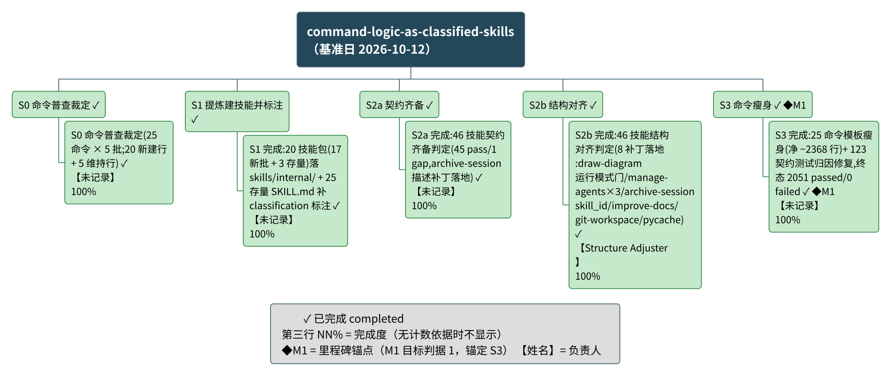

# command-logic-as-classified-skills 项目总结报告

## 项目概览

spec-kit 的命令核心逻辑尽可能由技能承载 —— 命令模板只保留入口与委派,可执行的核心逻辑落在 skills/ 下的技能里;每个技能的元数据都带 internal 或 external 标注,标注如实表达它与 spec-kit 的依赖关系(internal:只服务 spec-kit 框架自身逻辑;external:与 spec-kit 无依赖,任何项目皆可直接使用),使后续按标注分流的处理有据可依。（出处：Anchor 定义 `.specify/anchoring/command-logic-as-classified-skills/anchor.md` §Objective）

- **推进主体**：团队 command-logic-as-classified-skills,serial 五阶段链 —— S0 命令普查裁定 → S1 提炼建技能并标注 → S2a 契约齐备 → S2b 结构对齐 → S3 命令瘦身;每次交接设独立验证门,canonical 落盘后跑再生成两引擎。（出处：`.specify/teams/command-logic-as-classified-skills/team.md` §Dynamic Structure）
- **目标切片**：T-001(技能抽象与内外标注)/T-002(契约齐备与结构对齐)/T-003(命令瘦身),五阶段经团队映射逐一对应三条切片。（出处：`.specify/anchoring/command-logic-as-classified-skills/anchor.md` §Targets）
- **时间线**(实际起讫)：2026-10-09 S0 完成;2026-10-12 S1/S2a/S2b/S3 在同一轮运行中全部完成并通过交接判定。

> 材料声明：本项目材料未记录任何计划日期与工期,全文日期均为实际起讫记录;进度未与计划比对。

### 整体进度摘要
**整体完成度：-（无可计数依据）（截至 2026-10-12）**
无排期依据,进度未与计划比对;5 个阶段与 5 个工作项均为已完成。

| 进度视角 | 当前值 |
|----------|--------|
| 整体完成度 | -（无可计数依据）(口径：无勾选比、无材料明写百分比)|
| 工作项分布 | 已完成 10 / 进行中 0 / 未开始 0(共 10,含 5 个阶段聚合节点与 5 个工作项)|
| 里程碑达成 | 1/1 = 100.0%(逾期 0 个,待达成 0 个)|
| 逾期情况 | 逾期条目 0 项；无计划日期条目 10 项,无法判定延期 |

## 需求与特性

共 0 项特性（项目材料未按特性类目组织）。

> 材料声明：本项目表单 features[] 为空(团队条目台账不含特性类目);上一版报告曾自 git-ignored 工作区进度文件归集 4 条交付类目,本次按既有总结流重新生成后不再派生,差异已记入《材料缺口》。

| 特性 | 来源 | 状态 | 进度% | 负责人 |
|------|------|------|-------|--------|
| （无特性条目记录） | - | - | -（无可计数依据） | - |

## 功能分解

图说：本图以单一分解树呈现项目的阶段—工作项结构 —— 顶层为项目,第二层为五个阶段(S0、S1、S2a、S2b、S3),第三层为各阶段的工作项；✓ 表示已完成,第三行为完成度(各 100/100 = 100.0%),【未记录】为负责人(名册席位无可解析规范名,见《人员与分工》),◆M1 为里程碑锚点(锚定 S3 命令瘦身)。结论：5 个阶段与 5 个工作项均已完成(各 100/100 = 100.0%);逾期 0 项;全部条目无计划日期,无法判定延期(材料无排期,节点不含日期)。

### 工作项进度
**阶段级聚合**

| 阶段 | 状态 | 进度% | 已完成/共计 | 逾期天数 |
|------|------|-------|-------------|----------|
| S0 命令普查裁定 | 已完成 | Σ子项进度 100.0 / 子项数 1 = 100.0% | 1/1 | - |
| S1 提炼建技能并标注 | 已完成 | Σ子项进度 100.0 / 子项数 1 = 100.0% | 1/1 | - |
| S2a 契约齐备 | 已完成 | Σ子项进度 100.0 / 子项数 1 = 100.0% | 1/1 | - |
| S2b 结构对齐 | 已完成 | Σ子项进度 100.0 / 子项数 1 = 100.0% | 1/1 | - |
| S3 命令瘦身 | 已完成 | Σ子项进度 100.0 / 子项数 1 = 100.0% | 1/1 | - |

(阶段进度为引擎对子项的等权聚合;各阶段恰含 1 个工作项,聚合值与子项一致。)

**工作项级**

| ID | 工作项 | 所属阶段 | 状态 | 进度% | 计划起止 | 逾期天数 | 依据 |
|----|--------|----------|------|-------|----------|----------|------|
| TI-0001 | S0 命令普查裁定(25 命令 × 5 批;20 新建行 + 5 维持行) | S0 命令普查裁定 | 已完成 | 100/100 = 100.0% | 无计划日期 | - | 无计划完成日,无法判定延期 |
| TI-0002 | S1 完成:20 技能包(17 新批 + 3 存量)落 skills/internal/ + 25 存量 SKILL.md 补 classification 标注 | S1 提炼建技能并标注 | 已完成 | 100/100 = 100.0% | 无计划日期 | - | 无计划完成日,无法判定延期 |
| TI-0003 | S2a 完成:46 技能契约齐备判定(45 pass/1 gap,archive-session 描述补丁落地) | S2a 契约齐备 | 已完成 | 100/100 = 100.0% | 无计划日期 | - | 无计划完成日,无法判定延期 |
| TI-0004 | S2b 完成:46 技能结构对齐判定(8 补丁落地:draw-diagram 运行模式门/manage-agents×3/archive-session skill_id/improve-docs/git-workspace/pycache) | S2b 结构对齐 | 已完成 | 100/100 = 100.0% | 无计划日期 | - | 无计划完成日,无法判定延期 |
| TI-0005 | S3 完成:25 命令模板瘦身(净 −2368 行)+ 123 契约测试归因修复,终态 2051 passed/0 failed | S3 命令瘦身 | 已完成 | 100/100 = 100.0% | 无计划日期 | - | 无计划完成日,无法判定延期 |

(表内 ID 为团队侧局部形;装载进项目数据库时统一带团队命名空间前缀,归属另由来源路径冗余承载,见「元信息」。)

### 人员与分工
**人员维度覆盖率：已记录负责人的条目 5 / 全部条目 11（45.5%）（含推断 0 条）**

| 规范名 | 角色 | 负责条目 | 来源 |
|--------|------|----------|------|
| Structure Adjuster | structure-aligner(S2b 结构对齐) | TI-0004(S2b 结构对齐) | 团队名册 |
| 未记录(模板席位,定义 frontmatter 为占位符,无可解析名) | team-supervisor(serial Lead 与唯一 Meta 落盘者) / skill-author(S0/S1/S2a/S3 产出者) / contract-checker(交接独立判定席) | S0/S1/S2a/S3 四个阶段及其工作项(均记主产出席位) | 团队名册 `.specify/teams/command-logic-as-classified-skills/team.md` |
| 未记录(汇总行) | - | 5 个阶段聚合节点与里程碑 M1(未登记负责人) | - |

## 项目里程碑

**里程碑进度汇总**

| 指标 | 当前值 |
|------|--------|
| 达成率 | 1/1 = 100.0% |
| 已达成 / 逾期 / 待达成 | 1 / 0 / 0(共 1,另有无计划日期 0)|
| 最大逾期天数 | - |

| 编号 | 里程碑 | 锚定 | 状态 | 达成进度 | 延期天数 | 负责人 | 依据 |
|------|--------|------|------|----------|----------|--------|------|
| M1 | command 中只包含该调用哪些 skill 以及如何调用 skill,不包含具体的实现细节,所有的细节都在 skill 中(目标判据 1) | 工作项 TI-0005(S3 命令瘦身) | ✓ 已达成(2026-10-12) | -（无可计数依据） | - | 未记录 | 锚定 S3 命令瘦身结束点,换算为 2026-10-12;已达成：S3 判定 contract-checker PASS,终态契约测试 2051 passed / 0 failed,达成日 2026-10-12(不晚于锚定日) |

达成叙述：共 1 个里程碑,已达成 1 个(达成率 1/1 = 100.0%),逾期 0 个(最长 - 天),待达成 0 个。

> 状态说明：Anchor 定义本身未随派生总结改写;判据达成证据(`.specify/teams/command-logic-as-classified-skills/runs/20261012T115331Z-report.md`,2026-10-12)保持原记录。三个目标切片(T-001/T-002/T-003)同理,见「元信息 · 切片覆盖」。

里程碑图元承载说明：里程碑视图独立成图判据不成立(数量 1,低于独立成图下限 4),任务进展甘特亦未出图(无排期材料);M1 的锚定与状态由本节跟踪表承载。

## 任务进展

> 材料声明：本项目未提供任何计划日期与工期字段(实际起讫日有记录;排期判定结论为「无任何计划日期或工期依据 → 甘特不出图」),因此不呈现甘特图(today 参照线一并省去);下方以任务状态表与整体状态叙述替代,任务分解见《功能分解》。

**任务状态表**

| 工作项 | 所属阶段 | 状态 | 实际起讫 | 依据 |
|--------|----------|------|----------|------|
| S0 命令普查裁定(25 命令 × 5 批;20 新建行 + 5 维持行) | S0 命令普查裁定 | 已完成 | 2026-10-09 ~ 2026-10-09 | 无计划完成日,无法判定延期 |
| S1 完成:20 技能包(17 新批 + 3 存量)落 skills/internal/ + 25 存量 SKILL.md 补 classification 标注 | S1 提炼建技能并标注 | 已完成 | 2026-10-12 ~ 2026-10-12 | 无计划完成日,无法判定延期 |
| S2a 完成:46 技能契约齐备判定(45 pass/1 gap,archive-session 描述补丁落地) | S2a 契约齐备 | 已完成 | 2026-10-12 ~ 2026-10-12 | 无计划完成日,无法判定延期 |
| S2b 完成:46 技能结构对齐判定(8 补丁落地:draw-diagram 运行模式门/manage-agents×3/archive-session skill_id/improve-docs/git-workspace/pycache) | S2b 结构对齐 | 已完成 | 2026-10-12 ~ 2026-10-12 | 无计划完成日,无法判定延期 |
| S3 完成:25 命令模板瘦身(净 −2368 行)+ 123 契约测试归因修复,终态 2051 passed/0 failed | S3 命令瘦身 | 已完成 | 2026-10-12 ~ 2026-10-12 | 无计划完成日,无法判定延期 |

### 进度叙述
**整体**：截至 2026-10-12,整体完成度 -（无可计数依据）(口径：无勾选比、无材料明写百分比);无排期依据,进度未与计划比对;五个阶段链已全部完成。

| 阶段 | 起止 | 状态 | 进度% | 逾期天数 |
|------|------|------|-------|----------|
| S0 命令普查裁定 | 无计划日期 | 已完成 | Σ子项进度 100.0 / 子项数 1 = 100.0% | - |
| S1 提炼建技能并标注 | 无计划日期 | 已完成 | Σ子项进度 100.0 / 子项数 1 = 100.0% | - |
| S2a 契约齐备 | 无计划日期 | 已完成 | Σ子项进度 100.0 / 子项数 1 = 100.0% | - |
| S2b 结构对齐 | 无计划日期 | 已完成 | Σ子项进度 100.0 / 子项数 1 = 100.0% | - |
| S3 命令瘦身 | 无计划日期 | 已完成 | Σ子项进度 100.0 / 子项数 1 = 100.0% | - |

**完成度分布**：已完成 10 项、进行中 0 项、未开始 0 项(共 10;含阶段聚合节点;状态未知 0 项)。
**逾期**：逾期条目 0 项;无计划日期条目 10 项,无法判定延期(全部条目无排期依据,未判逾期、未上逾期色)。

## 元信息
- 生成日期：2026-10-12（= 基准日 D0,逐字传给引擎 `--baseline`）
- Anchor 身份：条目类为锚点类,定义 `.specify/anchoring/command-logic-as-classified-skills/anchor.md`;派生交付目录为 `.specify/anchoring/<slug>/summary/`(本次经既有总结流重生成,未手改定义)
- 输入信息源：
  - S-0001(用户表单口径)：团队 tracked 工件 `.specify/teams/command-logic-as-classified-skills/`(team.md、items.jsonl、runs/*-report.md),覆盖 phases / work_items / people
  - 表单由 `skills/internal/create-team/scripts/build-summary-input.py` 从团队工件派生(本次重生成),随后按「既有总结流源审查补填」方式从上一版 committed 表单与 Anchor 定义回填可溯源字段,每条回填均登记于「推断字段清单」
- 表单校验：`python3 skills/internal/summarize-project/scripts/validate-project-input.py --input data/project-input.yaml`（status=ready;R 档齐备）
- 推断字段清单（引擎汇总,共 33 条,按字段族归并）：
  - project.project_desc ← `.specify/anchoring/command-logic-as-classified-skills/anchor.md` §Objective(生成器按截断上限截取)
  - phases[5 条].phase_name ← 台账 phase_ref 对应的既有阶段名(既有总结流先前版本)
  - work_items[TI-0001..TI-0005].owner_id / actual_start / actual_end / depends_on(共 20 条) ← 团队 runs 报告(各条对应 `#deliverables`/`#s1`/`#s2a`/`#s2b`/`#s3` 锚)与既有总结流先前版本;depends_on 取 team.md Dynamic Structure DAG,非日期推断
  - milestones[MS-0001].anchor_item_id / actual_date / achieved_evidence / milestone_name(5 条) ← Anchor §Success Criteria 与团队 runs 报告 `20261012T115331Z`;生成器原锚 TI-0001 系兜底,已按判据 1 对应 S3 修正为 TI-0005
  - people[4 席].owner_role ← 团队定义 members 声明(既有总结流先前版本同源);其中 3 席 owner_name 仍无可解析名,记「未记录」
- 项目数据库：`python3 skills/internal/summarize-project/scripts/project-db.py --db data/project.db --load data/project-input.yaml`（schema 版本 project-db/v1;装载行数 people=4 phases=5 work_items=5 work_item_deps=4 milestones=1 features=0 sources=1 inferred_fields=33;完整性体检 ok;非 `--update` 模式,每次重建）
- 进度引擎运行：`python3 skills/internal/summarize-project/scripts/progress-engine.py --db data/project.db --baseline 2026-10-12 --out data/engine-out.json` —— 本报告全部状态/进度/延期数字出自该次运行（数据库与引擎输出为派生产物,落交付目录 `data/`、默认每次重建,未写入任何目标项目管理工件）
- 门禁确认状态：四道门禁以**非交互模式自动通过**(团队触发的自动刷新;未经逐层人工交互确认)
- 切片覆盖（targets）：T-001/T-002/T-003 均 authored_status=open,attributed_items 均为 0(台账行未打切片标记,生成器按台账计 0);切片轴为范围覆盖度,与判据轴分列,不推导 Anchor achieved;三切片达成证据见各阶段 runs 报告,待人工复核
- 估计假设：
  - 基准日取生成日 2026-10-12(无排期材料,未做任何计划对照)
  - 工作项/里程碑条目级负责人均未登记人员规范名,图内与表格按「未记录」呈现(非「未分配」)
  - check-coherence WARN 判读：CG-ID「123」系台账条目名中的契约测试计数(「123 契约测试归因修复」,运行报告原文照录),非 F-/S-/P-/T- 命名空间编号——判读为误报,保留原文
  - 渲染状态(附版面判读)：wbs | ok —— 5 分支树、10 个非根节点,长宽比约 2.34:1 高于 0.8~2.2 舒适区间上限,系串行链的固有宽度,节点数未达图集拆分阈值,判读为接受;里程碑视图 | 未出图(独立成图判据不成立：条目数 1 低于下限 4 且无日期跨度);任务进展甘特图 | 未出图(无排期材料);特性概览脑图 | 未出图(无特性条目)

### 进度数据来源
- 基准日 D0：2026-10-12（与生成日期一致）
- 引擎调用：`python3 skills/internal/summarize-project/scripts/progress-engine.py --db data/project.db --baseline 2026-10-12 --out data/engine-out.json`
- 本次生效阈值：weak_git_commits=10、weak_git_span_days=7、milestone_view_min_count=4、milestone_view_min_span_days=61、gantt_split_bars=20
- 分母口径：整体完成度 basis = null(无可计数依据);覆盖分母集合 = 团队条目台账 items.jsonl(5 项,已扣除剔除项 0)
- 未量化条目：0 项
- 字段 → 呈现位对照：
  - project.status_counts → 概览「工作项分布」、任务进展「完成度分布」
  - groups[].progress_pct / progress_formula → 功能分解阶段聚合行、任务进展分阶段表
  - items[].progress_pct / progress_formula → 功能分解工作项表、WBS 第三行
  - milestones.achieved_formula / achieved_bar / counts → 概览「里程碑达成」、里程碑汇总表、达成叙述
  - project.counts.delayed / delay_days_max / unknown_schedule → 概览「逾期情况」、任务进展「逾期」
  - coverage.closure_equation / coverage_formula / progress_denominator_set → 「分解树覆盖」
  - people.coverage_formula → 「人员与分工」首句
  - targets.items[].attributed_items / completed_items / pending_approval → 元信息「切片覆盖」

### 统计口径
| 口径 ID | 指标定义（字段） | 采集命令 | 范围 | 采集日 |
|---------|------------------|----------|------|--------|
| CAL-01 | project.progress.progress_pct（整体完成度） | progress-engine.py（元信息所列调用） | 全部条目 | 2026-10-12 |
| CAL-02 | project.status_counts（完成度分布计数） | progress-engine.py | 阶段 + 工作项实体（10） | 2026-10-12 |
| CAL-03 | project.counts.work_items / leaves（条目计数） | progress-engine.py | 同上 | 2026-10-12 |
| CAL-04 | milestones.achieved_formula / counts（里程碑汇总） | progress-engine.py | 1 个里程碑 | 2026-10-12 |
| CAL-05 | project.counts.delayed / delay_days_max / unknown_schedule（逾期与无排期） | progress-engine.py | 全部条目 | 2026-10-12 |
| CAL-06 | coverage.candidate_total / excluded / granularity_truncated / unattributed（覆盖计数） | progress-engine.py | 候选全集 C | 2026-10-12 |
| CAL-07 | people.coverage_numerator / coverage_denominator（人员覆盖率） | progress-engine.py | 11 个呈现实体 | 2026-10-12 |

### 分解树覆盖
分解树覆盖：候选全集 C = 团队条目台账 items.jsonl(5)
残差清单 R：R-未排期 0、R-未归属 0、R-已剔除 0、R-粒度截断 0
覆盖闭合等式：5 − 0 − 0 = 5
分母集合＝分解树覆盖范围(团队条目台账 items.jsonl,5 项,已扣除剔除项 0);覆盖率 5/5 = 100.0%。

### 材料缺口
| 缺什么 | 已检索来源 | 报告影响（不存在/降级的内容） |
|--------|-----------|------------------------------|
| 计划日期与工期（工作项与里程碑） | 表单 work_items[].planned_start/planned_end、milestones[].planned_date(均空);团队台账与 runs 报告均无排期材料 | 《任务进展》甘特图不出图;10 个条目判「无计划日期,无法判定延期」,不判逾期、不上红 |
| 特性清单 | 表单 features;团队台账无特性类目 | 《需求与特性》仅保留声明;上一版报告曾自 git-ignored 工作区进度文件归集的 4 条交付类目不再派生(该来源不被 tracked 表单摄取),特性概览图不出图 |
| S-layer 扩展切片条目 | team items.jsonl(5 条显式行);runs/ 四份报告 | 上一版报告中的 S-layer 工作项(其唯一出处为 git-ignored 工作区 progress.md)不再派生;该批剩余工作已于 2026-10-11 由承接团队 skill-layer-install-separation 完成并记入其自身总结 |
| 条目级负责人规范名 | 团队名册 4 席;其中 3 席定义 frontmatter 为占位符,无可解析名 | 三席产出席位在 WBS/表格记「未记录」;人员覆盖率 5/11 = 45.5% |
| 里程碑计划日期 | Anchor 判据无日期;团队材料无排期 | M1 锚定取 S3 实际完成日 2026-10-12(已达成),无计划对照;「达成进度」无计数依据 |
