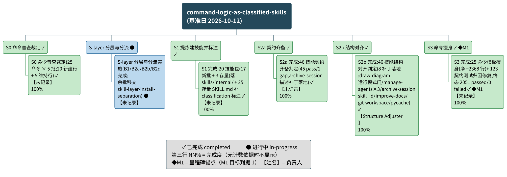

# command-logic-as-classified-skills 项目总结报告

## 项目概览

spec-kit 的命令核心逻辑尽可能由技能承载 —— 命令模板只保留入口与委派,可执行的核心逻辑落在 skills/ 下的技能里;每个技能的元数据都带 internal 或 external 标注,标注如实表达它与 spec-kit 的依赖关系(internal:只服务 spec-kit 框架自身逻辑;external:与 spec-kit 无依赖,任何项目皆可直接使用),使后续按标注分流的处理有据可依。（出处：目标定义 `.specify/goal/command-logic-as-classified-skills/goal.md` §Objective）

- **推进主体**：团队 command-logic-as-classified-skills,serial 五阶段链 —— S0 命令普查裁定 → S1 提炼建技能并标注 → S2a 契约齐备 → S2b 结构对齐 → S3 命令瘦身;每次交接设独立验证门,canonical 落盘后跑再生成两引擎。（出处：`.specify/teams/command-logic-as-classified-skills/team.md` §Dynamic Structure）
- **目标切片**：T-001(技能抽象与内外标注)/T-002(契约齐备与结构对齐)/T-003(命令瘦身),五阶段经团队映射逐一对应三条切片。
- **扩展切片**：2026-10-09 起新增「S-layer 分层与分流」(B1 分类 sweep、B2a git-workflow 状态面迁移、B2b create-docs/improve-docs 去 .specify 化、B2d git-workspace 四合一);其剩余批次 B2c/B2e/B3–B7 已于 2026-10-09 经用户指令移交 goal skill-layer-install-separation,移交件已由承接团队完成并判 achieved(2026-10-11)。
- **时间线**(实际起讫)：2026-10-09 S0 完成并启动 S-layer;2026-10-12 S1/S2a/S2b/S3 在同一轮运行中全部完成并通过交接判定。

> 材料声明：本项目材料未记录任何计划日期与工期,全文日期均为实际起讫记录;进度未与计划比对。

### 整体进度摘要
**整体完成度：-（无可计数依据）（截至 2026-10-12）**
无排期依据,进度未与计划比对。当前处于 S-layer 分层与分流(进行中;其剩余批次已移交另一 goal 并已由承接团队完成)。

| 进度视角 | 当前值 |
|----------|--------|
| 整体完成度 | -（无可计数依据）(口径：无勾选比、无材料明写百分比)|
| 工作项分布 | 已完成 13 / 进行中 3 / 未开始 0(共 16,含阶段聚合节点与特性条目)|
| 里程碑达成 | `██████████` 1/1 = 100.0%(逾期 0 个,待达成 0 个)|
| 逾期情况 | 逾期条目 0 项；无计划日期条目 16 项,无法判定延期 |

## 需求与特性

共 4 项交付物类目,已完成 3 项、进行中 1 项、未开始 0 项(截至 2026-10-12)。

| 特性 | 来源 | 状态 | 进度% | 负责人 |
|------|------|------|-------|--------|
| F-001 命令核心逻辑技能化 —— 20 个新技能包落位 skills/internal/ | `.specify/teams/command-logic-as-classified-skills/runs/20261012T115331Z-report.md`#s1 | 已完成 | 100/100 = 100.0% | 未记录 |
| F-002 全量技能分类标注 —— 25 个存量 SKILL.md 补 classification(internal 14 / external 11) | `.specify/teams/command-logic-as-classified-skills/runs/20261012T115331Z-report.md`#s1 | 已完成 | 100/100 = 100.0% | 未记录 |
| F-003 命令模板瘦身 —— 25 个命令改写为「技能调用 + 输入产出」,模板净减 2,368 行 | `.specify/teams/command-logic-as-classified-skills/runs/20261012T115331Z-report.md`#s3 | 已完成 | 100/100 = 100.0% | 未记录 |
| F-004 技能内外分层改造 —— B1 分类 sweep v2、B2a git-workflow 状态面迁移、B2b create-docs/improve-docs 去 .specify 化、B2d git-workspace 四合一 | `.specify/teams/.work/command-logic-as-classified-skills/progress.md`#s-layer | 进行中 | -（无可计数依据） | 未记录 |

> 材料声明：特性概览脑图未出图 —— 特性条目 4 行,低于概览图出图下限 8 行;特性类目系自团队进度文件的交付记录归集(归集依据见「元信息 · 推断字段清单」),非独立特性材料。

## 功能分解

图说：本图以单一分解树呈现项目的阶段—工作项结构 —— 顶层为项目,第二层为六个阶段(S0、S-layer、S1、S2a、S2b、S3,按实际发生序排列),第三层为各阶段的工作项；✓ 表示已完成、● 表示进行中,第三行为完成度(无计数依据的条目不显示该行),【姓名】为负责人(【未记录】= 名册席位无可解析名,见《人员与分工》),◆M1 为里程碑锚点(锚定 S3 命令瘦身)。结论：6 个工作项中 5 个已完成(各 100/100 = 100.0%)、1 个进行中(进度未量化);逾期 0 项;全部条目无计划日期,无法判定延期(材料无排期,节点不含日期)。

### 工作项进度
**阶段级聚合**

| 阶段 | 状态 | 进度% | 已完成/共计 | 逾期天数 |
|------|------|-------|-------------|----------|
| S0 命令普查裁定 | 已完成 | Σ子项进度 100.0 / 子项数 1 = 100.0% | 1/1 | - |
| S-layer 分层与分流 | 进行中 | -（无可计数依据） | 0/1 | - |
| S1 提炼建技能并标注 | 已完成 | Σ子项进度 100.0 / 子项数 1 = 100.0% | 1/1 | - |
| S2a 契约齐备 | 已完成 | Σ子项进度 100.0 / 子项数 1 = 100.0% | 1/1 | - |
| S2b 结构对齐 | 已完成 | Σ子项进度 100.0 / 子项数 1 = 100.0% | 1/1 | - |
| S3 命令瘦身 | 已完成 | Σ子项进度 100.0 / 子项数 1 = 100.0% | 1/1 | - |

(阶段进度为引擎对子项的等权聚合;S-layer 的子项进度未量化,未计入任何百分比分母。)

**工作项级**

| ID | 工作项 | 所属阶段 | 状态 | 进度% | 计划起止 | 逾期天数 | 依据 |
|----|--------|----------|------|-------|----------|----------|------|
| TI-0001 | S0 命令普查裁定(25 命令 × 5 批;20 新建行 + 5 维持行) | S0 命令普查裁定 | 已完成 | 100/100 = 100.0% | 无计划日期 | - | 无计划完成日,无法判定延期 |
| TIX-d3aa82b0 | S-layer 分层与分流实施(B1/B2a/B2b/B2d 完成;余批移交 skill-layer-install-separation) | S-layer 分层与分流 | 进行中 | -（无可计数依据） | 无计划日期 | - | 进度无可计数依据;无计划完成日,无法判定延期 |
| TI-0002 | S1 完成:20 技能包(17 新批 + 3 存量)落 skills/internal/ + 25 存量 SKILL.md 补 classification 标注 | S1 提炼建技能并标注 | 已完成 | 100/100 = 100.0% | 无计划日期 | - | 无计划完成日,无法判定延期 |
| TI-0003 | S2a 完成:46 技能契约齐备判定(45 pass/1 gap,archive-session 描述补丁落地) | S2a 契约齐备 | 已完成 | 100/100 = 100.0% | 无计划日期 | - | 无计划完成日,无法判定延期 |
| TI-0004 | S2b 完成:46 技能结构对齐判定(8 补丁落地:draw-diagram 运行模式门/manage-agents×3/archive-session skill_id/improve-docs/git-workspace/pycache) | S2b 结构对齐 | 已完成 | 100/100 = 100.0% | 无计划日期 | - | 无计划完成日,无法判定延期 |
| TI-0005 | S3 完成:25 命令模板瘦身(净 −2368 行)+ 123 契约测试归因修复,终态 2051 passed/0 failed | S3 命令瘦身 | 已完成 | 100/100 = 100.0% | 无计划日期 | - | 无计划完成日,无法判定延期 |

(表内 ID 为团队侧局部形;装载进项目数据库时统一带团队命名空间前缀,归属另由来源路径冗余承载,见「元信息」。)

### 人员与分工
**人员维度覆盖率：已记录负责人的条目 6 / 全部条目 17（35.3%）（含推断 0 条）**

| 规范名 | 角色 | 负责条目 | 来源 |
|--------|------|----------|------|
| Structure Adjuster | structure-aligner(S2b 结构对齐) | S2b 结构对齐 | 团队名册 + `.specify/agents/templates/structure-adjuster.agent.md` |
| 未记录(3 个 create-team 模板席位,其定义 frontmatter 为占位符,无可解析名) | team-supervisor(serial Lead 与唯一 Meta 落盘者) / skill-author(S0/S1/S2a/S3 产出者) / contract-checker(交接独立判定席) | S0 命令普查裁定、S-layer 分层与分流实施、S1 提炼建技能并标注、S2a 契约齐备性核查与修补、S3 命令瘦身(均记主产出席位) | 团队名册 `.specify/teams/command-logic-as-classified-skills/team.md` |
| 未记录(汇总行) | - | 阶段聚合节点 6 个、里程碑 M1、特性 F-001–F-004(未登记负责人) | - |

## 项目里程碑

**里程碑进度汇总**

| 指标 | 当前值 |
|------|--------|
| 达成率 | `██████████` 1/1 = 100.0% |
| 已达成 / 逾期 / 待达成 | 1 / 0 / 0(共 1,另有无计划日期 0)|
| 最大逾期天数 | - |

| 编号 | 里程碑 | 锚定 | 状态 | 达成进度 | 延期天数 | 负责人 | 依据 |
|------|--------|------|------|----------|----------|--------|------|
| M1 | command 中只包含该调用哪些 skill 以及如何调用 skill,不包含具体的实现细节,所有的细节都在 skill 中(目标判据 1) | 2026-10-12 | ✓ 已达成 | -（无可计数依据） | - | 未记录 | 锚定 S3 命令瘦身结束点,换算为 2026-10-12;已达成：S3 判定 contract-checker PASS,终态契约测试 2051 passed / 0 failed,达成日 2026-10-12(不晚于锚定日) |

达成叙述：共 1 个里程碑,已达成 1 个(达成率 1/1 = 100.0%),逾期 0 个(最长 - 天),待达成 0 个。

> 状态说明：goal 定义的 authored 状态仍为 active —— 判据达成来自团队 2026-10-12 运行的独立判定与证据(S3 交接判定 PASS,goal 判据咨询评估「已达成」),goal 层状态未自动翻转,待用户经 /speckit.goal 正式收官。三个目标切片(T-001/T-002/T-003)同理,见「元信息 · 切片覆盖」。

里程碑图元承载说明：里程碑视图独立成图判据不成立(数量 1,低于独立成图下限 4),任务进展甘特亦未出图(无排期材料);M1 的锚定日期与状态由本节跟踪表承载。

## 任务进展

> 材料声明：本项目未提供任何计划日期与工期字段(实际起讫日有记录;排期判定结论为「无任何计划日期或工期依据 → 甘特不出图」),因此不呈现甘特图(today 参照线一并省去);下方以任务状态表与整体状态叙述替代,任务分解见《功能分解》。

**任务状态表**

| 工作项 | 所属阶段 | 状态 | 实际起讫 | 依据 |
|--------|----------|------|----------|------|
| S0 命令普查裁定(25 命令 × 5 批;20 新建行 + 5 维持行) | S0 命令普查裁定 | 已完成 | 2026-10-09 ~ 2026-10-09 | 无计划完成日,无法判定延期 |
| S-layer 分层与分流实施(B1/B2a/B2b/B2d 完成;余批移交 skill-layer-install-separation) | S-layer 分层与分流 | 进行中 | 2026-10-09 ~ (未完成;移交件已由承接团队完成) | 进度无可计数依据;无计划完成日,无法判定延期 |
| S1 完成:20 技能包(17 新批 + 3 存量)落 skills/internal/ + 25 存量 SKILL.md 补 classification 标注 | S1 提炼建技能并标注 | 已完成 | 2026-10-12 ~ 2026-10-12 | 无计划完成日,无法判定延期 |
| S2a 完成:46 技能契约齐备判定(45 pass/1 gap,archive-session 描述补丁落地) | S2a 契约齐备 | 已完成 | 2026-10-12 ~ 2026-10-12 | 无计划完成日,无法判定延期 |
| S2b 完成:46 技能结构对齐判定(8 补丁落地:draw-diagram 运行模式门/manage-agents×3/archive-session skill_id/improve-docs/git-workspace/pycache) | S2b 结构对齐 | 已完成 | 2026-10-12 ~ 2026-10-12 | 无计划完成日,无法判定延期 |
| S3 完成:25 命令模板瘦身(净 −2368 行)+ 123 契约测试归因修复,终态 2051 passed/0 failed | S3 命令瘦身 | 已完成 | 2026-10-12 ~ 2026-10-12 | 无计划完成日,无法判定延期 |

### 进度叙述
**整体**：截至 2026-10-12,整体完成度 -（无可计数依据）(口径：无勾选比、无材料明写百分比);无排期依据,进度未与计划比对;当前处于 S-layer 分层与分流(其剩余批次已移交 goal skill-layer-install-separation)。

| 阶段 | 起止 | 状态 | 进度% | 逾期天数 |
|------|------|------|-------|----------|
| S0 命令普查裁定 | 无计划日期 | 已完成 | Σ子项进度 100.0 / 子项数 1 = 100.0% | - |
| S-layer 分层与分流 | 无计划日期 | 进行中 | -（无可计数依据） | - |
| S1 提炼建技能并标注 | 无计划日期 | 已完成 | Σ子项进度 100.0 / 子项数 1 = 100.0% | - |
| S2a 契约齐备 | 无计划日期 | 已完成 | Σ子项进度 100.0 / 子项数 1 = 100.0% | - |
| S2b 结构对齐 | 无计划日期 | 已完成 | Σ子项进度 100.0 / 子项数 1 = 100.0% | - |
| S3 命令瘦身 | 无计划日期 | 已完成 | Σ子项进度 100.0 / 子项数 1 = 100.0% | - |

**完成度分布**：已完成 13 项、进行中 3 项(共 16;含阶段聚合节点与特性条目;未开始 0 项、状态未知 0 项、本轮延后 0 项)。
**逾期**：逾期条目 0 项;无计划日期条目 16 项,无法判定延期(全部条目无排期依据,未判逾期、未上逾期色)。

## 元信息
- 生成日期：2026-10-12（= 基准日 D0,逐字传给引擎 `--baseline`）
- goal 身份：explicit —— team.md frontmatter 显式声明 `goal_slug: command-logic-as-classified-skills`;交付目录由 goal_slug 派生(不由团队 slug 派生)
- 输入信息源：
  - S-0001(用户表单口径)：团队 tracked 工件 `.specify/teams/command-logic-as-classified-skills/`(team.md、items.jsonl、runs/*-report.md),覆盖 phases / work_items / milestones / people
  - S-0002(用户表单口径,调度方明确授权的补填源)：`.specify/teams/.work/command-logic-as-classified-skills/progress.md`(git-ignored 工作区进度文件),覆盖 work_items / features / milestones
  - S-0003(用户表单口径)：goal 定义 `.specify/goal/command-logic-as-classified-skills/goal.md`,覆盖 milestones
  - 表单由 `skills/internal/create-team/scripts/build-summary-input.py` 从团队工件派生,本次刷新按上述源审查补填;生成器对该 team.md 的 frontmatter 解析失败(YAML 流式映射错误),由此产生的三处退化(project_desc 截断、goal 身份误标 inferred、Write Scope 未声明)已按 team.md 与 goal.md 修正,`roster.md` 同步更正并留更正记录
- 表单校验：`python3 skills/internal/summarize-project/scripts/validate-project-input.py --input data/project-input.yaml`（status=ready;R 档齐备）
- 推断字段清单（引擎汇总,共 18 条,逐条「字段 ← 依据」）：
  - project.project_desc ← goal.md §Objective(生成器解析失败回退截断,按定义修正)
  - project.baseline_date ← 本次总结刷新触发日 2026-10-12(生成日期 = 基准日;生成器原取台账最近事件日 2026-10-09)
  - work_items[TIX-d3aa82b0(S-layer)] ← 两态交接回填 —— progress.md Stage Progress 表(台账尚无该条目显式行);TIX = sha256(标题+phase_ref) 前 8 位
  - work_items[TI-0002..TI-0005] ← **刷新进行期间团队 cycle 并发落盘**的台账显式行(items.jsonl TI-0002..TI-0005 + runs/20261012T115331Z-report.md,tracked);按「每次从全部团队台账重新折叠」重新装载,显式身份为权威,先前的 4 条推断身份(TIX-ff531ace/39cc250d/44c744f5/0ff78b5d)按两态交接归并、不再呈现
  - work_items[*].actual_start/actual_end ← progress.md Stage Progress 表 Started/Completed 列;S0 起讫取 runs/20261009T032057Z-report.md 执行时间戳
  - work_items[*].depends_on ← team.md Dynamic Structure DAG(S0→S1→S2a→S2b→S3),非日期推断
  - work_items[*].owner_id ← team.md 各 stage 的 agent_kind 指派(S0/S1/S2a/S3/S-layer → skill-author 席;S2b → structure-aligner 席;S-layer 记主产出席)
  - people[structure-adjuster].owner_name ← `.specify/agents/templates/structure-adjuster.agent.md` frontmatter name(解析顺序第 2 级)
  - people[agent-team-supervisor-template / agent-stage-executor-template / agent-stage-evaluator-template].owner_name ← 记 未记录(三席为 create-team 临时模板,定义 frontmatter name 为占位符)
  - milestones[MS-0001].anchor_item_id ← team.md config.target_map(目标判据 1 对应 T-003 → S3-command-thinning);生成器原锚 TI-0001 系单条目时的兜底
  - features[F-001..F-004] ← runs/20261012T115331Z-report.md 与 progress.md S-layer 批计划 的交付类目归集
  - targets.items[].attributed_items/completed_items(T-001 2/2、T-002 2/2、T-003 1/1) ← team.md config.target_map(台账行未打切片标记,生成器按台账计 0)
  - phases[6 个].source ← 条目未写来源,按 sources[] 声明推断
- 项目数据库：`python3 skills/internal/summarize-project/scripts/project-db.py --db data/project.db --load data/project-input.yaml`（schema 版本 project-db/v1;装载行数 people=4 phases=6 work_items=6 work_item_deps=4 milestones=1 features=4 sources=3 coverage=1 inferred_fields=18;完整性体检 ok;非 `--update` 模式,每次重建;台账并发追加后重新装载一次,以上为终态折叠）
- 进度引擎运行：`python3 skills/internal/summarize-project/scripts/progress-engine.py --db data/project.db --baseline 2026-10-12 --out data/engine-out.json` —— 本报告全部状态/进度/延期数字出自该次运行（数据库与引擎输出为派生产物,落交付目录 `data/`、默认每次重建,未写入任何目标项目管理工件）
- 门禁确认状态：四道门禁以**非交互模式自动通过**(团队触发的自动刷新;未经逐层人工交互确认)
- 切片覆盖（targets）：T-001 已归属 2 完成 2(TI-0001、S1);T-002 已归属 2 完成 2(S2a、S2b);T-003 已归属 1 完成 1(S3);另有 1 条未归属任何切片(S-layer 扩展切片,其归属切片未在 goal 定义设立)。三条切片 authored 状态均仍 open 而证据全完成 → **待人工复核**(待经 `/speckit.goal targets --set done` 关闭);authored 口径下切片覆盖 0/3 done,切片轴与判据轴分列,不推导 goal achieved
- 估计假设：
  - 基准日取生成日 2026-10-12(无排期材料,未做任何计划对照)
  - S-layer 工作项状态取团队 Stage Progress 表最新信号(进行中);其剩余批次属跨团队范围移交且已由承接团队完成(2026-10-11),非本团队内停滞
  - 工作项/里程碑条目级负责人均未登记人员规范名,图内与表格按「未记录」呈现(非「未分配」)
  - check-coherence WARN 判读：CG-ID「123」系台账条目名中的契约测试计数(「123 契约测试归因修复」,运行报告原文照录),非 F-/S-/P-/T- 命名空间编号——判读为误报,保留原文
  - 渲染状态(附版面判读)：wbs | ok —— 可读性通过;长宽比 2.86:1 高于 0.8~2.2 舒适区间,系六分支串行链的固有宽度,节点数 12 ≤ 15 不触发图集拆分,判读为接受;里程碑视图 | 未出图(独立成图判据不成立：数量 1 < 4);任务进展甘特图 | 未出图(无排期材料);特性概览脑图 | 未出图(4 行 < 8 行下限)

### 进度数据来源
- 基准日 D0：2026-10-12（与生成日期一致）
- 引擎调用：`python3 skills/internal/summarize-project/scripts/progress-engine.py --db data/project.db --baseline 2026-10-12 --out data/engine-out.json`
- 本次生效阈值：weak_git_commits=10、weak_git_span_days=7、milestone_view_min_count=4、milestone_view_min_span_days=61、gantt_split_bars=20
- 分母口径：整体完成度 basis = null(无可计数依据);覆盖分母集合 = 团队条目台账 items.jsonl(5 条显式)+ 台账未及条目回填(1 条推断:S-layer,两态交接)+ 交付类目 features(4 条)（10 项,已扣除剔除项 0）
- 未量化条目：3 项(S-layer 工作项、S-layer 阶段聚合、F-004)——已在各呈现位写 `-（无可计数依据）`,未计入任何百分比分母
- 字段 → 呈现位对照：
  - project.status_counts → 概览「工作项分布」、任务进展「完成度分布」
  - groups[].progress_pct / progress_formula → 功能分解阶段聚合行、任务进展分阶段表
  - items[].progress_pct / progress_formula → 功能分解工作项表、WBS 第三行
  - milestones.achieved_formula / achieved_bar / counts → 概览「里程碑达成」、里程碑汇总表、达成叙述
  - project.counts.delayed / delay_days_max / unknown_schedule → 概览「逾期情况」、任务进展「逾期」
  - coverage.closure_equation / coverage_formula / progress_denominator_set → 「分解树覆盖」
  - people.coverage_formula → 「人员与分工」首句
  - targets.items[].attributed_items / completed_items / pending_approval → 元信息「切片覆盖」

### 统计口径
| 口径 ID | 指标定义（字段） | 采集命令 | 范围 | 采集日 |
|---------|------------------|----------|------|--------|
| CAL-01 | project.progress.progress_pct（整体完成度） | progress-engine.py（元信息所列调用） | 全部条目 | 2026-10-12 |
| CAL-02 | project.status_counts（完成度分布计数） | progress-engine.py | 阶段 + 工作项 + 特性实体（16） | 2026-10-12 |
| CAL-03 | project.counts.work_items / leaves（条目计数） | progress-engine.py | 同上 | 2026-10-12 |
| CAL-04 | milestones.achieved_formula / counts（里程碑汇总） | progress-engine.py | 1 个里程碑 | 2026-10-12 |
| CAL-05 | project.counts.delayed / delay_days_max / unknown_schedule（逾期与无排期） | progress-engine.py | 全部条目 | 2026-10-12 |
| CAL-06 | coverage.candidate_total / excluded / granularity_truncated / unattributed（覆盖计数） | progress-engine.py | 候选全集 C | 2026-10-12 |
| CAL-07 | people.coverage_formula（人员覆盖率） | progress-engine.py | 17 个呈现实体 | 2026-10-12 |
| CAL-08 | targets.items[].attributed_items / completed_items / pending_approval（切片覆盖计数） | build-summary-input.py（表单派生）+ team.md config.target_map | T-001/T-002/T-003 | 2026-10-12 |

### 状态映射
| 源状态字面量 | 归一化态 | 使用位置 |
|--------------|----------|----------|
| 已完成 | completed(引擎默认映射) | 工作项 5 条、特性 3 条 |
| 进行中 | in-progress(引擎默认映射) | 工作项 1 条、特性 1 条 |

- 未映射字面量：无（引擎诊断的未映射清单为空）。
- 记录未闭合项清单：无（本项目无规格/任务清单工件,不适用勾选类触发;特性与工作项状态均有进度文件或运行报告出处）。
- 目标项目自身生命周期定义：团队台账的状态枚举为 completed / in-progress / delayed / not-started / unknown（items.jsonl 口径）;本报告出现的三条目均为前两态,默认映射与之语义一致,未启用 status_map 覆盖。

### 分解树覆盖
分解树覆盖：候选全集 C = 团队条目台账 items.jsonl(5 条显式)+ 台账未及条目回填(1 条推断:S-layer,两态交接)+ 交付类目 features(4 条)（10）
残差清单 R：R-未排期 0、R-未归属 0、R-已剔除 0、R-粒度截断 0
覆盖闭合：10 − 0 − 0 = 10（= 分解树条目数 = 进度分母集合大小）
覆盖率：10/10 = 100.0%
进度分母集合：团队条目台账 items.jsonl(5 条显式)+ 台账未及条目回填(1 条推断:S-layer,两态交接)+ 交付类目 features(4 条)（10 项,已扣除剔除项 0）
（4 条特性与工作项同源：F-001/F-002 ← S1、F-003 ← S3、F-004 ← S-layer;特性维度呈现于《需求与特性》,不重复入树。）

### 材料缺口
| 缺什么 | 已检索来源 | 报告影响（不存在/降级的内容） |
|--------|-----------|------------------------------|
| 计划日期与工期（工作项与里程碑） | 表单 work_items[].planned_start/planned_end、milestones[].planned_date(均空);团队台账与进度文件均无排期材料 | 《任务进展》甘特图不出图;16 个条目判「无计划日期,无法判定延期」,不判逾期、不上红 |
| S-layer 的 tracked 台账行 | items.jsonl(5 条显式行 TI-0001..TI-0005,含本刷新期间并发追加的 4 条)、runs/ 四份报告 | S-layer 条目尚无显式台账行,以推断身份回填,出处指向 git-ignored 工作区 progress.md(经调度方明确授权);待团队主管追加显式台账行后按两态交接归并 |
| 条目级负责人规范名 | 团队名册 4 席;其中 3 个 create-team 模板席位的定义 frontmatter 为占位符,无可解析名 | 该三席产出席位在 WBS/表格记「未记录」;人员覆盖率 6/17 = 35.3% |
| 里程碑计划日期 | goal.md 判据无日期;团队材料无排期 | M1 锚定取 S3 实际完成日 2026-10-12(已达成),无计划对照;「达成进度」无计数依据 |
| 特性概览脑图 | 特性条目 4 行,低于概览图出图下限 8 行 | 特性概览图不出图,《需求与特性》以表格承载 |
