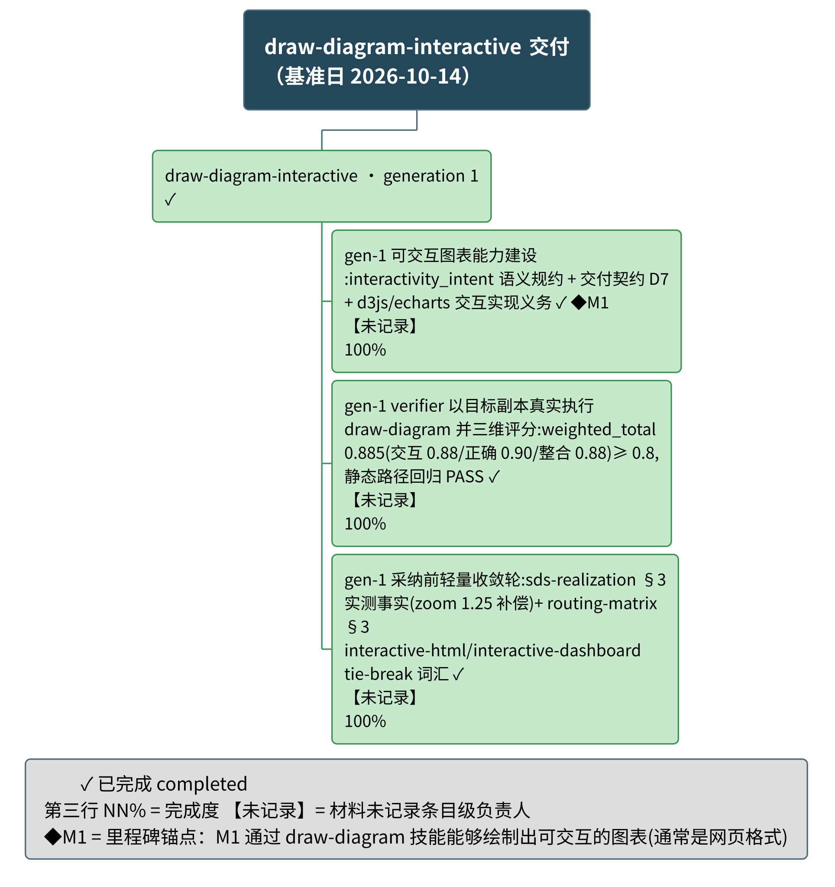

# draw-diagram-interactive 项目总结报告

## 项目概览

**背景**：draw-diagram 技能是统一的图表绘制技能（单一入口、内部分引擎图层），此前已覆盖静态图表绘制路径。本 goal（draw-diagram-interactive）以 iteration 闭环团队的形式为该技能补齐**可交互图表**绘制能力——图表可根据用户输入做出调整，通常以网页格式交付。团队由三类角色构成：团队主管（目标分解、评分决策、采纳落盘）、能力构建者（改进技能目标工作副本）、技能验证者（以副本真实执行技能、三维评分、静态路径回归），按「目标副本改进 → 以副本真实执行 → 三维评分 → 达标采纳」单谱系收敛循环推进（出处：团队定义《绘图技能交互图表能力建设团队》、goal 定义）。

**目标**（出处：goal 定义 · Objective）：

- draw-diagram 技能具备绘制可交互图表的能力：图表可根据用户输入做出调整。

**范围**：

- 范围内：「动态」指图表随用户输入做出调整（交互的结果），交互形式含点击 / 悬停 / 筛选 / 展开收起任一；交付物通常为网页格式（出处：goal 边界、团队质量维度定义）。
- 范围外：动画 / 动图 / 视频等形式上的动态（出处：goal 边界）。

### 整体进度摘要

**整体完成度：-（无可计数依据）（截至 2026-10-14）**。无排期依据，进度未与计划比对。

| 进度视角 | 当前值 |
|----------|--------|
| 整体完成度 | -（无可计数依据）（口径：无勾选比、无材料明写百分比，只报状态计数） |
| 工作项分布 | 已完成 4 / 进行中 0 / 未开始 0（共 4） |
| 里程碑达成 | 无可计数依据（已达成 0 / 全部 1，其中 1 个无计划日期、无法判定延期） |
| 逾期情况 | 逾期条目 0 项，最长逾期 -；4 个工作项无计划完成日，无法判定延期 |

> 材料声明：表单未提供任何计划 / 实际日期与工期字段，也无勾选计数或材料明写的完成百分比；项目级完成度无可计数依据，只报状态计数。条目级完成度按引擎口径由状态定义给出（已完成条目为满值，见《功能分解》）。

## 需求与特性

> 材料声明：表单未提供特性清单（特性一组为空），上下文与用户提供的外部材料中也未归集出特性行，因此本节不含特性清单表格与特性概览图（概览图判定：特性行数不足且无可指认的分组依据，不出图）。已检索：项目输入表单的特性段（空）、goal 定义的成功标准（该判据以《项目里程碑》M1 承载，未登记为特性）、团队条目台账（能力建设条目以《功能分解》工作项承载）。

## 功能分解

<!-- 图源：assets/wbs.puml（@startwbs 单一分解树：阶段 → 任务；四态样式类按零实例退化仅含 .done + 状态符号 + 【负责人】第二行 + NN% 第三行 + ◆M1 里程碑锚点） -->

**图说**：

- **是什么**：截至 2026-10-14，本 goal 的单一功能分解树——1 个阶段（generation 1）与 3 项工作项，条目全部源自团队条目台账。
- **怎么读**：浅绿 `✓` = 已完成；节点第二行【未记录】= 材料未记录条目级负责人（非"未分配"）；第三行 `NN%` = 完成度（引擎口径，已完成条目为满值）；`◆M1` = 里程碑锚点，M1 为「通过 draw-diagram 技能能够绘制出可交互的图表(通常是网页格式)」。
- **结论**：阶段「draw-diagram-interactive · generation 1」下 3 项工作项全部完成（Σ子项进度 300.0 / 子项数 3 = 100.0%）；逾期条目 0 项，4 个条目无计划完成日、无法判定延期，故未作排期比对。

### 工作项进度

**阶段级聚合**

| 阶段 | 状态 | 进度% | 已完成/共计 | 逾期天数 |
|------|------|-------|-------------|----------|
| draw-diagram-interactive · generation 1 | 已完成 | Σ子项进度 300.0 / 子项数 3 = 100.0% | 3/3 | - |

（阶段日期为空：无计划起止，不呈现阶段时间包络；进度聚合为等权口径，无未量化被排除项。）

**工作项级**

| ID | 工作项 | 所属阶段 | 状态 | 进度% | 计划起止 | 逾期天数 | 依据 |
|----|--------|----------|------|-------|----------|----------|------|
| draw-diagram-interactive.TI-0001 | gen-1 可交互图表能力建设:interactivity_intent 语义规约 + 交付契约 D7 + d3js/echarts 交互实现义务 | draw-diagram-interactive · generation 1 | 已完成 | 100/100 = 100.0% | 未排期 | -（无计划日期，无法判定延期） | `.specify/teams/draw-diagram-interactive/runs/20261014T1710Z-report.md#deliverables` |
| draw-diagram-interactive.TI-0002 | gen-1 verifier 以目标副本真实执行 draw-diagram 并三维评分:weighted_total 0.885(交互 0.88/正确 0.90/整合 0.88)≥ 0.8,静态路径回归 PASS | draw-diagram-interactive · generation 1 | 已完成 | 100/100 = 100.0% | 未排期 | -（无计划日期，无法判定延期） | `.specify/teams/draw-diagram-interactive/runs/20261014T1710Z-report.md#verification` |
| draw-diagram-interactive.TI-0003 | gen-1 采纳前轻量收敛轮:sds-realization §3 实测事实(zoom 1.25 补偿)+ routing-matrix §3 interactive-html/interactive-dashboard tie-break 词汇 | draw-diagram-interactive · generation 1 | 已完成 | 100/100 = 100.0% | 未排期 | -（无计划日期，无法判定延期） | `.specify/teams/draw-diagram-interactive/runs/20261014T1710Z-report.md#execution-detail` |

### 人员与分工

**人员维度覆盖率：已记录负责人的条目 0 / 全部条目 5（0/5 = 0.0%），其中 0 条为推断。**

项目级名册 3 人（团队角色，未回填条目级负责人）：

| 规范名 | 角色 | 负责条目 | 来源 |
|--------|------|----------|------|
| 未记录 | team-supervisor | -（项目级名册，未回填条目） | 团队定义成员表 |
| 未记录 | capability-builder | -（项目级名册，未回填条目） | 团队定义成员表 |
| Skill Verifier | capability-verifier | -（项目级名册，未回填条目） | 团队定义成员表 |
| 未记录 | - | draw-diagram-interactive.PH-0001、draw-diagram-interactive.TI-0001、draw-diagram-interactive.TI-0002、draw-diagram-interactive.TI-0003、MS-0001 | —（条目级负责人材料未记录） |

> 材料声明：已检索表单人员名册（3 条团队角色）与各条目的负责人字段（全部为空）；条目级负责人按合法终态记「未记录」，未按姓名或提交内容臆断归属。repo 取材未声明（repos 为空），不做 git 作者推断。

## 项目里程碑

**里程碑进度汇总**

| 指标 | 当前值 |
|------|--------|
| 达成率 | -（无可计数依据） |
| 已达成 / 逾期 / 待达成 | 0 / 0 / 0（共 1，另有无计划日期 1） |
| 最大逾期天数 | - |

**里程碑跟踪表**

| 编号 | 里程碑 | 锚定 | 状态 | 达成进度 | 延期天数 | 负责人 | 依据 |
|------|--------|------|------|----------|----------|--------|------|
| M1 | 通过 draw-diagram 技能能够绘制出可交互的图表(通常是网页格式) | 未排期 | 无计划日期（无法判定延期） | -（无可计数依据） | - | 未记录 | 锚定工作项 TI-0001，但该工作项无计划/实际完成日，锚定日不可换算（来源：`.specify/goal/draw-diagram-interactive/goal.md`） |

**里程碑达成率：无可计数依据（已达成 0 / 全部 1；其中 1 个无计划日期，无法判定延期）。**

达成叙述：共 1 个里程碑，已达成 0 个（达成率无可计数依据），逾期 0 个，待达成 0 个，无计划日期 1 个（无法判定延期）。

> 材料声明：里程碑 M1 无计划日期（无绝对锚定日，锚定工作项亦无计划/实际完成日，锚定日不可换算），因此**无法判定是否延期**——本报告如实标注为「无计划日期」，既不判为逾期（不上红）、也不视作按期；未用提交日期等推断基线代替计划日。里程碑图元判定：不出任何里程碑图（独立成图条件未满足——数量与时间跨度均不足；且无排期材料、《任务进展》甘特图未出图，里程碑亦因无日期无法在时间轴落点）——M1 状态仅以本节汇总表与跟踪表承载。

## 任务进展

> 材料声明：表单未提供任何计划 / 实际日期与工期字段（全部工作项的起止日期为空，亦无工期依据与日期锚点），引擎判定排期材料不足 → **不呈现甘特图**；today 参照线随之省去。下方以任务状态表与整体状态叙述替代，任务分解结构见《功能分解》WBS 图。

**任务状态表**

| 条目 | 类型 | 状态 | 进度 | 计划完成日 |
|------|------|------|------|-----------|
| draw-diagram-interactive · generation 1 | 阶段 | 已完成 | Σ子项进度 300.0 / 子项数 3 = 100.0% | 未排期 |
| gen-1 可交互图表能力建设:interactivity_intent 语义规约 + 交付契约 D7 + d3js/echarts 交互实现义务 | 工作项 | 已完成 | 100/100 = 100.0% | 未排期 |
| gen-1 verifier 以目标副本真实执行 draw-diagram 并三维评分:weighted_total 0.885(交互 0.88/正确 0.90/整合 0.88)≥ 0.8,静态路径回归 PASS | 工作项 | 已完成 | 100/100 = 100.0% | 未排期 |
| gen-1 采纳前轻量收敛轮:sds-realization §3 实测事实(zoom 1.25 补偿)+ routing-matrix §3 interactive-html/interactive-dashboard tie-break 词汇 | 工作项 | 已完成 | 100/100 = 100.0% | 未排期 |
| 通过 draw-diagram 技能能够绘制出可交互的图表(通常是网页格式) | 里程碑 | 无计划日期（无法判定延期） | -（无可计数依据） | 未排期 |

### 进度叙述

**整体**：截至 2026-10-14，整体完成度 -（无可计数依据）（口径：无勾选比、无材料明写百分比，只报状态计数）；无排期依据，进度未与计划比对。

| 阶段 | 起止 | 状态 | 进度% | 逾期天数 |
|------|------|------|-------|----------|
| draw-diagram-interactive · generation 1 | 未排期 | 已完成 | Σ子项进度 300.0 / 子项数 3 = 100.0% | - |

**完成度分布**：已完成 4 项、进行中 0 项、未开始 0 项（共 4 项）。阶段「draw-diagram-interactive · generation 1」状态由 3 个子项聚合得出：已完成（Σ子项进度 300.0 / 子项数 3 = 100.0%）。

**逾期**：逾期条目 0 项，最长逾期 -。4 个工作项无计划完成日，无法判定延期（未判逾期、未上逾期色，也未用推断基线补计划日）。

## 元信息

- 生成日期：2026-10-14（= 基准日 D0，取表单 `project.baseline_date`，逐字传给引擎 `--baseline`）
- 输入信息源：表单 `data/project-input.yaml`（聚合范围 = 绑定本 goal 的全部团队，本 goal 仅 1 个团队）；`sources[]`：S-0001（user-form → `.specify/teams/draw-diagram-interactive/`，覆盖工作项 / 阶段 / 人员）；里程碑来源：`.specify/goal/draw-diagram-interactive/goal.md`
- 表单校验：`python3 .specify/skills/internal/summarize-project/scripts/validate-project-input.py --input data/project-input.yaml --db data/project.db --json` → status=ready，退出码 0；实体计数：阶段 1 / 工作项 3 / 里程碑 1 / 人员 3 / 特性 0 / 来源 1（features=0 按技能降级规则显式声明，见《需求与特性》与 `### 材料缺口`）
- 状态映射（本次实际使用）：「已完成」→ completed（3 项工作项，映射执行在引擎，映射来源 `status_raw:已完成`）；阶段状态由 3 个子项聚合（completed）；里程碑状态由引擎按锚定日与基准日判定（M1 → 无计划日期）。未映射状态字面量：无
- 推断字段清单：`phases[draw-diagram-interactive.PH-0001].source` ← 条目未写来源，按 `sources[]` 声明推断（值：`.specify/teams/draw-diagram-interactive/（user-form）`）；另：依赖字段缺失 → 不画依赖虚线（不虚构依赖），里程碑状态缺失 → 由引擎判定
- 项目数据库：`python3 .specify/skills/internal/summarize-project/scripts/project-db.py --db data/project.db --load data/project-input.yaml` → schema 版本 project-db/v1，装载 people=3 phases=1 work_items=3 milestones=1 sources=1 coverage=1 project=1，完整性体检 ok，退出码 0；本次为 `--load`（重建）模式
- 进度引擎运行：`python3 .specify/skills/internal/summarize-project/scripts/progress-engine.py --db data/project.db --baseline 2026-10-14 --out data/engine-out.json` → 退出码 0；本报告全部状态 / 进度 / 延期数字出自该次运行；数据库与引擎输出为派生产物，落交付目录 `data/`，未写入目标项目管理工件
- 统计口径：

  | 口径 ID | 指标定义（分子 / 分母） | 采集命令 | 范围 | 采集日 |
  |---------|------------------------|----------|------|--------|
  | M-OVERALL | 项目整体完成度（无可计数依据：无勾选比、无材料明写百分比） | `progress-engine.py --db data/project.db --baseline 2026-10-14 --out data/engine-out.json` | 交付目录 `data/project.db` | 2026-10-14 |
  | M-PHASE | 阶段聚合进度 = Σ子项进度 / 子项数（等权，引擎聚合） | 同上 | 同上（子项 3） | 2026-10-14 |
  | M-ITEM | 工作项进度 = 100/100（状态已完成按定义满值） | 同上 | 同上 | 2026-10-14 |
  | M-COVER | 分解树覆盖率 = 3/3 | 同上 | 同上 | 2026-10-14 |
  | M-MS | 里程碑达成率（无可计数依据：达成率分母为 0——全部里程碑无计划日期） | 同上 | 同上 | 2026-10-14 |
  | M-PEOPLE | 人员维度覆盖率 = 0/5（有负责人字段的条目 / 全部条目） | 同上 | 同上 | 2026-10-14 |

- 记录未闭合项：无
- 估计假设：无
- 渲染状态：功能分解 WBS | ok（`assets/wbs.svg` + `assets/wbs.png`，同名配对；版面量测与数据侧校验均通过）
- 呈现判定记录：甘特图不出图（引擎排期材料判定：无任何计划日期或工期依据 → 甘特不出图）；里程碑图不出图（判定阶梯步骤 3：独立成图条件 (a) 不成立——数量 1 低于阈值 4、时间跨度缺失，(b) 不成立（甘特未拆分），(c) 未限定受众粒度；形态 B 条件不成立——里程碑数不足且达成进度无可计数依据）；特性概览图不出图（特性行数 0，不足阈值且无分组依据）；图集拆分未触发（WBS 节点数 4 ≤ 15）；甘特 today 偏移未产出（无项目起点）
- 非交互模式：本次运行为非交互模式（调用方声明，不向用户提问），四道确认门禁（项目概览 / 项目里程碑 / 功能分解 WBS / 任务进展）**未经交互确认**、自动通过
- 分解树覆盖：候选全集 C = 团队条目台账 items.jsonl（3）；残差清单 R：R-未排期 0、R-未归属 0、R-已剔除 0（无）、R-粒度截断 0；覆盖闭合：3 − 0 − 0 = 3（= 分解树工作项数 = 进度分母集合大小）；覆盖率：3/3 = 100.0%；进度分母集合：团队条目台账 items.jsonl（3 项，已扣除剔除项 0）

### 进度数据来源

- 基准日 D0：2026-10-14（与生成日期一致）
- 引擎调用：`python3 .specify/skills/internal/summarize-project/scripts/progress-engine.py --db data/project.db --baseline 2026-10-14 --out data/engine-out.json`
- 本次生效阈值（照抄引擎输出，仅供复核）：弱 git 材料提交数下限 10 / 跨度下限 7 天；里程碑视图独立成图下限：数量 4 / 跨度 61 天；甘特拆分下限 20 条
- 分母口径：项目级完成度无可计数依据（无勾选比、无材料明写百分比）；分解树进度分母集合 = 团队条目台账 items.jsonl（3 项，已扣除剔除项 0），与分解树覆盖范围一致
- 未量化条目：0 项（工作项与阶段为「已完成」状态，条目级完成度按定义满值；里程碑达成进度无可计数依据）
- 字段 → 呈现位对照：项目整体完成度 → 概览摘要 / 进度叙述；阶段聚合进度 → 功能分解阶段行 / 任务进展阶段表 / WBS 图说结论；条目进度 → 工作项进度表 / 任务状态表 / WBS 第三行；里程碑达成计数 → 概览摘要 / 里程碑汇总表 / 达成叙述；逾期计数 → 概览摘要 / 进度叙述 / WBS 图说结论；人员覆盖率 → 人员与分工首句；覆盖率 → 元信息分解树覆盖

### 材料缺口

| 缺什么 | 已检索来源 | 报告影响（不存在/降级的内容） |
|--------|-----------|------------------------------|
| 计划 / 实际日期与工期 | 表单工作项与里程碑的起止日期字段（全空）、外部进度文档 / 看板导出（未提供） | 不呈现《任务进展》甘特图与 today 参照线；全部条目「未排期」，无法判定延期 |
| 里程碑锚定日 | 表单里程碑计划日期字段（空）、锚定工作项 TI-0001（无计划/实际完成日，不可换算） | M1 锚定列「未排期」，不入时间轴视图；里程碑视图与达成进度图均不出图 |
| 项目级进度百分比 | 表单勾选计数与材料明写百分比（均无） | 项目整体完成度 `-（无可计数依据）`，只报状态计数；无整体进度条 |
| 条目级负责人 | 表单人员名册（3 条团队角色）与各条目负责人字段（空）、repo 作者推断（repos 未声明，未执行） | WBS【未记录】、跟踪表负责人「未记录」；覆盖率 0/5 = 0.0% |
| 特性清单 | 表单特性段（空）、需求文档（未提供） | 《需求与特性》退化为声明；特性概览图不出图 |
| 达成依据（里程碑） | 表单达成日期与达成依据字段（空）、验收记录（未提供） | M1 状态由引擎判为「无计划日期」，达成率无可计数依据 |

### 门禁补记（CG-4 WARN 处置）

check-coherence 2 条 CG-4 WARN（100.0% 疑似无分母）经人工核对为**误报**：两处被标记文本（WBS 阶段聚合与整体叙述）均已携带显式分子/分母「Σ子项进度 300.0 / 子项数 3 = 100.0%」，且数值为引擎实算（engine-out.json），非引用外部原文。按门禁「人工确认后登记入元信息」协议在此登记，原文不改。
