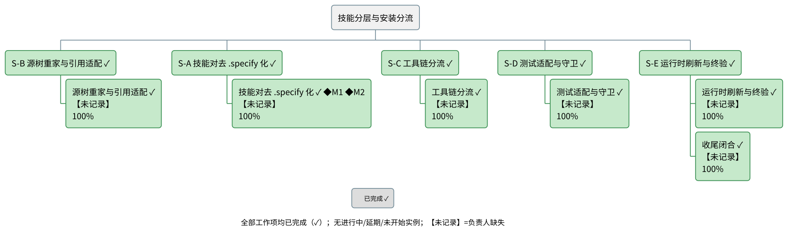

# skill-layer-install-separation 项目总结报告

## 项目概览

spec-kit 的技能完成 internal/external 分层落地与安装分流：技能源树按内外两层组织且全仓引用一致；客户项目只获得并注册 external 技能；internal 技能以 `.specify/skills/internal/` 嵌套下发、对客户 agent 不可见，仅供 `/speckit.*` 工作流按显式路径消费；框架自身两态齐备，镜像、安装、打包与测试工具链整链适配。

- 目标与范围出处：`.specify/goal/skill-layer-install-separation/goal.md`（目标定义）；工作项与阶段派生自团队条目台账 `.specify/teams/skill-layer-install-separation/`。
- 项目以串行阶段推进（S-A 技能对去 .specify 化 → S-B 源树重家与引用适配 → S-C 工具链分流 → S-D 测试适配与守卫 → S-E 运行时刷新与终验）；**五个阶段全部完成**。

> 材料声明：本项目未记录任何计划/实际日期与工期字段，以下进度摘要按可计数口径呈现，未与计划比对。

### 整体进度摘要
**整体完成度：-（无可计数依据）（截至 2026-10-09）**
无排期依据，进度未与计划比对。

| 进度视角 | 当前值 |
|----------|--------|
| 整体完成度 | -（无可计数依据）|
| 工作项分布 | 已完成 11 / 进行中 0 / 未开始 0（共 11）|
| 里程碑达成 | -（无可计数依据）（逾期 0 个，待达成 0 个；无计划日期 2 个）|
| 逾期情况 | 逾期条目 0 项；无计划日期条目无法判定延期（11 项）|

## 需求与特性

共 0 项特性（项目材料未按特性类目组织）。

> 材料声明：本项目未记录特性清单（工作项未按特性类目组织，表单 features[] 为空）。本节不含特性概览图；交付物以《功能分解》的工作项为单位呈现。

| 特性 | 来源 | 状态 | 进度% | 负责人 |
|------|------|------|-------|--------|
| （无特性条目记录） | - | - | -（无可计数依据） | - |

## 功能分解

图说：本图以单一分解树呈现项目的阶段—工作项结构——顶层为项目，第二层为五个阶段（S-A 至 S-E），第三层为各阶段的工作项；✓ 表示已完成，第三行为完成度（各 100/100 = 100.0%），【未记录】表示条目级负责人缺失，◆M1/◆M2 为里程碑锚点（两个里程碑均锚定首个工作项）。结论：5 个阶段、6 个工作项均已完成（各 100/100 = 100.0%）；逾期条目 0。

### 工作项进度
**阶段级聚合**

| 阶段 | 状态 | 进度% | 已完成/共计 | 逾期天数 |
|------|------|-------|-------------|----------|
| S-A 技能对去 .specify 化 | 已完成 | 100.0% | 1/1 | - |
| S-B 源树重家与引用适配 | 已完成 | 100.0% | 1/1 | - |
| S-C 工具链分流 | 已完成 | 100.0% | 1/1 | - |
| S-D 测试适配与守卫 | 已完成 | 100.0% | 1/1 | - |
| S-E 运行时刷新与终验 | 已完成 | 100.0% | 2/2 | - |

**工作项级**

| ID | 工作项 | 所属阶段 | 状态 | 进度% | 计划起止 | 逾期天数 | 依据 |
|----|--------|----------|------|-------|----------|----------|------|
| TI-0001 | S-A 技能对去 .specify 化（create-skills + improve-skills，独立复核通过） | S-A 技能对去 .specify 化 | 已完成 | 100.0% | 无计划日期 | - | 无计划完成日，无法判定延期 |
| TI-0002 | S-B 源树重家（32→17/15）与全引用面适配（G1 裁定放行） | S-B 源树重家与引用适配 | 已完成 | 100.0% | 无计划日期 | - | 无计划完成日，无法判定延期 |
| TI-0003 | S-C 工具链分流（镜像两对映射、安装两层复制与迁移、打包验证） | S-C 工具链分流 | 已完成 | 100.0% | 无计划日期 | - | 无计划完成日，无法判定延期 |
| TI-0004 | S-D 测试面全量适配、两条守卫（红绿演练）与全量 A/B 零新增 | S-D 测试适配与守卫 | 已完成 | 100.0% | 无计划日期 | - | 无计划完成日，无法判定延期 |
| TI-0005 | S-E 运行时刷新与目标判据终验 | S-E 运行时刷新与终验 | 已完成 | 100.0% | 无计划日期 | - | 无计划完成日，无法判定延期 |
| TI-0006 | 收尾闭合（终检全绿、遗留项收口：clarify 按名引用删除、/tmp 泄漏回收、pycache 清理） | S-E 运行时刷新与终验 | 已完成 | 100.0% | 无计划日期 | - | 无计划完成日，无法判定延期 |

### 人员与分工
**人员维度覆盖率：已记录负责人的条目 0 / 全部条目 13（0.0%）**（含推断 0 条）

| 规范名 | 角色 | 负责条目 | 来源 |
|--------|------|----------|------|
| framework-engineer | framework-engineer | -（条目未登记负责人） | 团队名册 |
| Structure Adjuster | structure-aligner | -（条目未登记负责人） | 团队名册 |
| Skill Verifier | contract-checker | -（条目未登记负责人） | 团队名册 |
| 未记录（含名册中定义未解析的席位） | team-supervisor | S-A 至 S-E 阶段与 TI-0001..TI-0006、MS-0001、MS-0002 | 条目 owner_id 为空；名册引用的 agent 定义未解析 |

## 项目里程碑

**里程碑进度汇总**

| 指标 | 当前值 |
|------|--------|
| 达成率 | -（无可计数依据）|
| 已达成 / 逾期 / 待达成 | 0 / 0 / 0（共 2，另有无计划日期 2）|
| 最大逾期天数 | - |

| 编号 | 里程碑 | 锚定 | 状态 | 达成进度 | 延期天数 | 负责人 | 依据 |
|------|--------|------|------|----------|----------|--------|------|
| M1 | 源树与运行时双布局按内外两层一致落地（全仓引用与所在层匹配；镜像、安装、打包三引擎按两层映射） | 工作项 TI-0001（S-A 技能对去 .specify 化） | 无计划日期，无法判定延期 | -（无可计数依据） | - | 未记录 | 锚定工作项无计划/实际完成日，锚定日不可换算；无计划日期，无法判定延期 |
| M2 | 分流行为可验证（平铺发现面只注册 external 技能；internal 技能经显式路径可解析） | 工作项 TI-0001（S-A 技能对去 .specify 化） | 无计划日期，无法判定延期 | -（无可计数依据） | - | 未记录 | 锚定工作项无计划/实际完成日，锚定日不可换算；无计划日期，无法判定延期 |

达成叙述：共 2 个里程碑，已达成 0 个（达成率 -（无可计数依据）），逾期 0 个（最长 - 天），待达成 0 个，无计划日期 2 个（无法判定延期）。

> 材料声明：2 个里程碑均无计划日期，无法判定延期——既不判为逾期（不上红）、也不视作按期；未用其他日期推断代替计划日。里程碑视图独立成图判据不成立（条目数低于独立成图下限且无日期锚点），亦未合并进《任务进展》（本项目无排期材料、甘特未出图）。

## 任务进展

> 材料声明：表单未提供任何计划/实际日期与工期字段，因此不呈现甘特图（today 参照线一并省去）；下方以任务状态表与整体状态叙述替代。任务分解见《功能分解》。

**任务状态表**

| 工作项 | 所属阶段 | 状态 | 来源 |
|--------|----------|------|------|
| S-A 技能对去 .specify 化 | S-A 技能对去 .specify 化 | 已完成 | 团队条目台账 |
| S-B 源树重家与引用适配 | S-B 源树重家与引用适配 | 已完成 | 团队条目台账 |
| S-C 工具链分流 | S-C 工具链分流 | 已完成 | 团队条目台账 |
| S-D 测试适配与守卫 | S-D 测试适配与守卫 | 已完成 | 团队条目台账 |
| S-E 运行时刷新与终验 | S-E 运行时刷新与终验 | 已完成 | 团队条目台账 |

### 进度叙述
**整体**：截至 2026-10-09，整体进度未量化，仅报状态计数：已完成 11 项、进行中 0 项、未开始 0 项；无排期依据，进度未与计划比对。

| 阶段 | 起止 | 状态 | 进度% | 逾期天数 |
|------|------|------|-------|----------|
| S-A 技能对去 .specify 化 | 无计划日期 | 已完成 | 100.0% | - |
| S-B 源树重家与引用适配 | 无计划日期 | 已完成 | 100.0% | - |
| S-C 工具链分流 | 无计划日期 | 已完成 | 100.0% | - |
| S-D 测试适配与守卫 | 无计划日期 | 已完成 | 100.0% | - |
| S-E 运行时刷新与终验 | 无计划日期 | 已完成 | 100.0% | - |

**完成度分布**：已完成 11 项、进行中 0 项、未开始 0 项（共 11）。
**逾期**：逾期条目 0 项；无计划日期条目无法判定延期（11 项）。

## 元信息
- 生成日期：2026-10-09（= 基准日 D0，逐字传给引擎 `--baseline`）
- 输入信息源：团队条目台账 `.specify/teams/skill-layer-install-separation/`（user-form 声明，覆盖 work_items / phases / people）；goal 定义 `.specify/goal/skill-layer-install-separation/goal.md`；表单由 `build-summary-input.py` 从团队工件派生（本版为收尾闭合后刷新，含全弧 6 条台账）
- 表单校验：`python3 ${SKILL_HOME}/scripts/validate-project-input.py --input data/project-input.yaml`（status=ready；R 档齐备）
- 推断字段清单：
  - people[agent-team-supervisor-template].owner_name ← 名册引用的 agent 定义未找到，按 FR-004 记为未记录
  - phases[*].source ← 条目未写来源，按 sources[] 声明推断（user-form）
- 项目数据库：`python3 ${SKILL_HOME}/scripts/project-db.py --db data/project.db --load data/project-input.yaml`（schema 版本 project-db/v1；装载与体检 ok；非 `--update` 模式，每次重建）
- 进度引擎运行：`python3 ${SKILL_HOME}/scripts/progress-engine.py --db data/project.db --baseline 2026-10-09 --out data/engine-out.json`——本报告全部状态/进度/延期数字出自该次运行（数据库与引擎输出为派生产物，落交付目录 `data/`、默认每次重建，未写入任何目标项目管理工件）
- 门禁确认状态：四道门禁以**非交互模式自动通过**（团队触发的自动刷新；未经逐层人工交互确认）
- 估计假设：
  - 基准日取生成日 2026-10-09；无排期材料，未做任何计划对照
  - 工作项/里程碑条目级负责人均未登记，人员标注一律 `未记录`（非「未分配」）
- 渲染状态：wbs | ok（版面量测附注：5 分支树长宽比 4.32 高于舒适区间、显示端最小字号 11.2px 略低于 12px 阈值——渲染器已按 preserveAspectRatio=meet 归一显示视口，图可读；此附注为已披露的版面取舍）；里程碑视图 | 未出图（独立成图判据不成立：无日期锚点且条目数低于下限）；任务进展甘特图 | 未出图（无排期材料）；特性概览 | 未出图（无特性材料）

### 进度数据来源
- 基准日 D0：2026-10-09（与生成日期一致）
- 引擎调用：`python3 ${SKILL_HOME}/scripts/progress-engine.py --db data/project.db --baseline 2026-10-09 --out data/engine-out.json`
- 本次生效阈值：weak_git_commits=10、weak_git_span_days=7、milestone_view_min_count=4、milestone_view_min_span_days=61、gantt_split_bars=20
- 分母口径：progress.basis = null（无可计数依据）；coverage.progress_denominator_set = 团队条目台账 items.jsonl（5 项，已扣除剔除项 0）
- 未量化条目：0 项
- 字段 → 呈现位对照：
  - project.status_counts → 项目概览摘要「工作项分布」、任务进展「完成度分布」
  - groups[].progress_pct → 功能分解阶段聚合行、任务进展分阶段表
  - items[].progress_pct → 功能分解工作项表、WBS 节点第三行
  - milestones.counts / achieved_formula → 项目概览摘要、里程碑汇总表、达成叙述
  - project.counts.delayed / delay_days_max → 概览摘要「逾期情况」、任务进展「逾期」
  - coverage.* → 分解树覆盖声明

### 统计口径
| 口径 ID | 指标定义（字段） | 采集命令 | 范围 | 采集日 |
|---------|------------------|----------|------|--------|
| CAL-01 | project.progress.progress_pct（整体完成度） | progress-engine.py（本报告元信息所列调用） | 全部工作项 | 2026-10-09 |
| CAL-02 | project.status_counts（完成度分布计数） | progress-engine.py | 阶段 + 工作项实体 | 2026-10-09 |
| CAL-03 | project.counts.work_items / leaves（工作项计数） | progress-engine.py | 同上 | 2026-10-09 |
| CAL-04 | milestones.counts / achieved_formula（里程碑汇总） | progress-engine.py | 2 个里程碑 | 2026-10-09 |
| CAL-05 | project.counts.delayed / project.delay_days_max（逾期） | progress-engine.py | 全部条目 | 2026-10-09 |
| CAL-06 | coverage.candidate_total / excluded / granularity_truncated / unattributed（覆盖计数） | progress-engine.py | 候选全集 C | 2026-10-09 |
| CAL-07 | people.coverage_numerator / coverage_denominator（人员覆盖率） | progress-engine.py | 13 个呈现实体 | 2026-10-09 |

### 分解树覆盖
分解树覆盖：候选全集 C = 团队条目台账 items.jsonl（6）
残差清单 R：R-未排期 0、R-未归属 0、R-已剔除 0、R-粒度截断 0
覆盖闭合等式：6 − 0 − 0 = 6
分母集合＝分解树覆盖范围（团队条目台账 items.jsonl，6 项，已扣除剔除项 0）；覆盖率 6/6 = 100%。

### 材料缺口
| 缺什么 | 已检索来源 | 报告影响（不存在/降级的内容） |
|--------|-----------|------------------------------|
| 计划日期与工期（工作项与里程碑） | 表单 work_items[].planned_start/planned_end、milestones[].planned_date（均空）；派生源团队台账（无排期信息） | 《任务进展》甘特图不出图；相关条目判「无计划日期，无法判定延期」，不判逾期、不上红 |
| 特性清单 | 表单 features[]（空）；团队台账无特性类目 | 《需求与特性》仅保留声明；特性概览图不出图 |
| 条目级负责人 | 表单条目 owner_id（空）；团队名册仅含席位级名称 | WBS/里程碑/表均标 `未记录`（部分缺失形态） |
| 进度百分比 | 表单 work_items[].checks / progress_pct（空）；无外部进度材料 | 整体完成度 -（无可计数依据）；各进度呈现位按合法终态呈现 |
| 里程碑达成日期 | 表单 milestones[].actual_date（空）、锚定工作项无完成日 | 达成率 -（无可计数依据）；里程碑视图不出图 |
