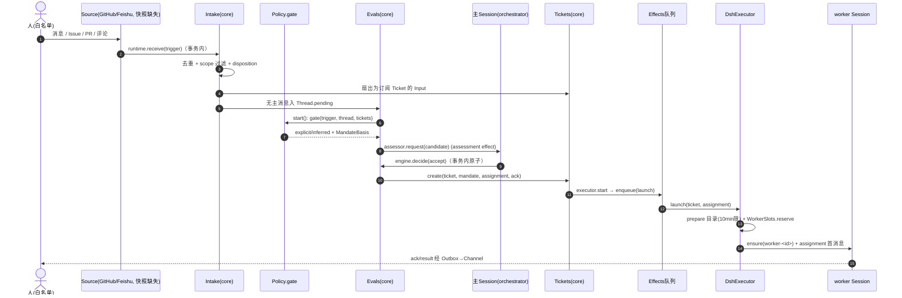
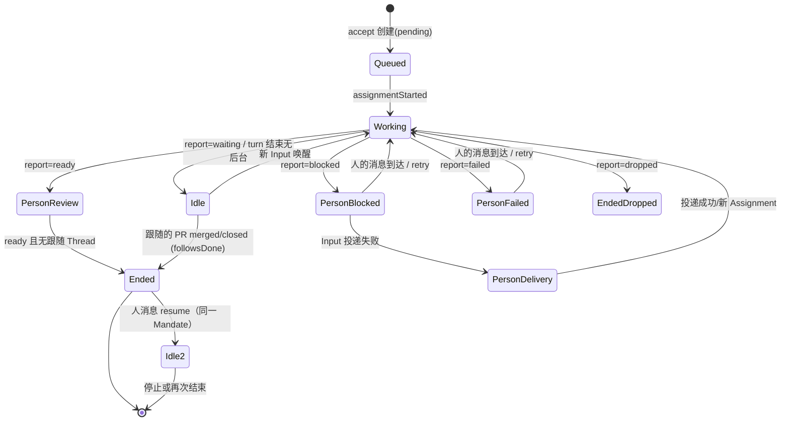
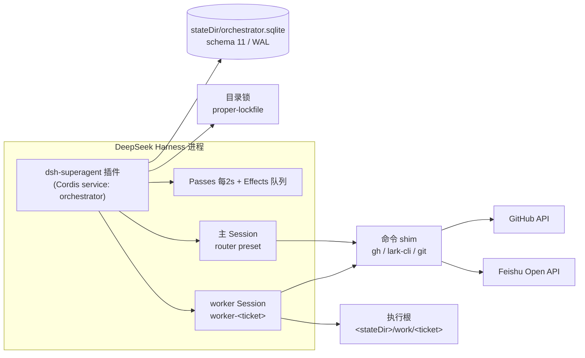

# dsh-superagent-prototype — 架构研读报告（可索引）

> **范围与证据约定**：本报告研究目标仓库 `deepseek-ai/dsh-superagent-prototype` 在工作区快照 `8c32a9dc`（单提交、shallow）上的内容。证据路径 `src/…`、`docs/…`、`prompts/…` 相对该目标仓库根；本次运行在研读工作区保留了一份可直接打开的副本（`../stripped/`），路径一一对应。目标仓库本身**未被修改**。
>
> **图件降级说明**：UML 主视图的 `.puml` 源已按计划写入 `figures/`，但本次运行环境无法访问 draw-diagram 渲染后端（`xuanji-render.aliyun-inc.com:9696–9701` 均不可达），按 uml-visualization-guide 的降级规则，正文以 Mermaid 草图呈现主视图；后端可用后可直接用同目录 `.puml` 渲染替换。

## 索引表（概念/组件 → 锚点 → 证据）

| 概念 / 组件 | 章节锚点 | 证据（file:line） |
|---|---|---|
| Source / Trigger / Thread | [#2.1 概念与术语表](#21-概念与术语表) | `src/core/model.ts:23-39`, `src/core/model.ts:156-182`, `src/core/intake.ts:19-62` |
| Eval / Gate / Assessment / Decision | [#2.1](#21-概念与术语表), [#5.1 授权闸门](#51-授权闸门为什么消息内容无法改变权限) | `src/core/evals.ts:71-119`, `src/core/evals.ts:131-156`, `src/policy.ts:191-211` |
| Mandate / Strength / Accept mode | [#2.1](#21-概念与术语表), [#5.1](#51-授权闸门为什么消息内容无法改变权限) | `src/core/model.ts:96-133`, `src/policy.ts:141`, `src/core/evals.ts:306-316` |
| Ticket / Assignment / Subscription / Channel | [#2.1](#21-概念与术语表), [#3.2 组件清单](#32-组件清单按业务功能划分) | `src/core/model.ts:211-308`, `src/core/tickets.ts:37-56`, `src/core/assignments.ts:30-140` |
| Policy 版本与重验证 | [#5.1](#51-授权闸门为什么消息内容无法改变权限) | `src/policy.ts:111-118`, `src/policy.ts:144-165`, `src/policy.ts:213-240` |
| Engine（领域内核，五部件） | [#3.2](#32-组件清单按业务功能划分) | `src/core/engine.ts:24-270`, `src/core/part.ts:24-80` |
| Runtime（组合根） | [#3.2](#32-组件清单按业务功能划分), [#3.4 运行拓扑](#34-运行拓扑单进程) | `src/app/runtime.ts:59-253` |
| Effects / Outbox（持久副作用） | [#5.2 崩溃一致性](#52-崩溃一致性状态与副作用同事务) | `src/app/effects.ts:46-161`, `src/app/outbox.ts:22-52` |
| DshExecutor / WorkerSlots / 后台工作 | [#3.2](#32-组件清单按业务功能划分), [#5.3](#53-worker-槽与人优先), [#5.5 恢复](#55-执行恢复三层事实) | `src/executor/dsh.ts:166-199`, `src/executor/dsh.ts:207-673`, `src/executor/background.ts:96-165` |
| MasterAssessor / 会话工具 | [#3.2](#32-组件清单按业务功能划分), [#3.3 协作](#33-组件如何协作叙事) | `src/app/assessment.ts:89-282`, `src/app/tools/main.ts:154-301`, `src/app/tools/executor.ts:23-105` |
| 面板（HTTP/views/client） | [#3.2](#32-组件清单按业务功能划分) | `src/app/http.ts:230`, `src/client/index.tsx`, `docs/005-panel.md:14-24` |
| 注意力预算（noWait / 回复规则 / 去噪） | [#5.4](#54-注意力预算的硬实现) | `src/app/sessions.ts:77-...`, `src/core/replies.ts:48-95`, `src/app/notices.ts:121-129` |
| 提示词装配与覆盖 | [#5.6](#56-提示词装配可覆盖可演进不可越权) | `src/app/prompts.ts:24-120`, `docs/004-prompts.md:40-73` |
| 快照完整性/文档冲突 | [#6 完整性说明](#6-快照完整性与文档-代码冲突重要发现) | `README.md:5,15-31`, 缺失 import 清单 |

---

## 1. 它是什么（问题与定位）

dsh-superagent 是**一个 GitHub 仓库（可选加 Feishu）的主动式编码 Agent**，作为 DeepSeek Harness（DSH）的 Cordis 插件 Bundle 运行。它监听事件；当被允许的人请求工作时，开一张工单（Ticket），在自己的 Agent Session 与目录里干活，回到原会话里回应（通常是 PR）；一个 Web 面板展示"哪里需要人"（`README.md:7-9`）。项目自称研究原型、非官方产品（`README.md:3-5`）。

真正的设计主线是一句可检验的原则：**"Take as little human attention as possible, and give as much value as possible"**（`docs/000-philosophy.md:3-15`）。它不是文案口号，而被编码成三组硬约束：

1. **行动约束**：只在被点名（stated request）或书面规则允许时行动；主动工作默认在 `observe` 模式只记录"would accept"（`docs/000:11`, `docs/002:97-99`, `src/policy.ts:55-57`）。
2. **发言约束**：只在人必须动作或能使用结果时说话；进度报告不转发（`docs/000:12`, `src/app/notices.ts:121-129`）。
3. **等待约束**：主 Session 不允许阻塞等待（`sleep`/长超时被工具守卫拒绝），因为等待会延迟所有新候选（`src/app/sessions.ts:77-…`, `docs/004:78`）。

**为什么需要独立设计而不是"更强的编码 Agent"**：一个能替全团队干活的 Agent 也能消耗全团队注意力。本项目把"主动性"拆成**可审计的授权链**（谁、依据什么规则、范围多大，记录在 Mandate 上），并把"是否打扰人"做成领域规则与工具强制，而不是提示词建议（`docs/001-domain.md:3-7`, `docs/004:65-73`）。

## 2. 核心概念

### 2.1 概念与术语表

项目用一套小而封闭的词汇建模：**Source、Trigger、Thread、Eval、Mandate、Subscription** 是核心域；Ticket、Assignment、Channel、Policy、Input、Report、Attention 支撑之（`docs/001:21-37`）。完整术语（含中文名与封闭值集）见 `docs/001:75-113` 与面板 `src/client/locales.ts`。

| 概念 | 一句话定义 | 代码落点 |
|---|---|---|
| Source | 事件流；kind 为可复用实现、instance 为一次配置；自持读取位点与 bot 身份 | 消费侧 `src/core/model.ts:23-39`；门控 `src/policy.ts:133` |
| Trigger | 一条不可变事件（actor / human / addressed / meta）；审计与幂等的最小单元 | `src/core/model.ts:23-39` |
| Thread | 时间序 Trigger 集合；同时最多一个 Eval；订阅与 Decision 历史的聚合边界 | `src/core/model.ts:156-182` |
| Correlation | 同一 Trigger 所属多个 Thread 的关联；只添上下文、**永不路由** | `src/core/model.ts:170-171`, `src/core/intake.ts:37` |
| Channel | Thread 的写侧地址 | `src/core/model.ts:9`；发送 `src/app/outbox.ts:39-51` |
| Policy | 版本化准入规则 + 每个 Source 的部分（白名单/准入表/bot 列表） | `src/policy.ts:111-118,191-240` |
| Eval | 对一批 Trigger 的判定：gate（确定性）+ assessment（模型），无状态 | `src/core/evals.ts:71-119` |
| Mandate | accept 授予的不可变授权：强度、Policy 版本、gate 依据、范围 | `src/core/model.ts:116-133`, `src/core/evals.ts:306-316` |
| Ticket | 授权的工作单元；open↔ended 可 resume；自己定义状态 | `src/core/model.ts:277-308`, `src/core/tickets.ts:37-363` |
| Assignment | Ticket ↔ 一个执行器实例的绑定（pending→running→ended） | `src/core/model.ts:211-233` |
| Subscription | Ticket ↔ Thread 多对多；匹配 Trigger 扇出为上下文、不重新鉴权 | `src/core/model.ts:163-164`, `src/core/intake.ts:38-52` |
| Strength | `explicit`（白名单点名/明确准入格）vs `inferred`（推断候选） | `src/core/model.ts:96`, `src/policy.ts:141` |
| Accept mode | `off` / `observe`（默认，记录 would-accept）/ `auto` | `src/core/model.ts:99-103`, `src/policy.ts:55-57` |
| Attention | Ticket 上等待人回答的结构化问题 | `src/core/model.ts:275`, `src/core/stage.ts:12` |
| Disposition | Trigger 去向轨迹（filtered/eval/fan-out/handback/acked） | `src/core/model.ts:41-61`, `src/core/intake.ts:54-55` |
| Main Session / Executor Session | `orchestrator` 只路由；`worker-<ticket>` 每 Ticket 一个、干活 | `src/app/sessions.ts:48`, `src/executor/dsh.ts:24` |

**关键咬合**：Source 产生 Trigger → Intake 去重/过滤/记录去向/扇出/入 Eval（`src/core/intake.ts:19-62`）→ gate 定强度与 `MandateBasis`（`src/policy.ts:191-211`）→ accept 原子创建 Ticket+Mandate+首个 Assignment+订阅+ack（`src/core/evals.ts:306-316`, `src/core/tickets.ts:37-56`）→ Assignment 经 Executor 执行 → 人后续消息经订阅回到 Ticket（不重新鉴权），执行器决定或交回（`src/core/model.ts:75-88`, `src/core/part.ts:42-48`）。

**被刻意拒绝的概念**（`docs/001:45-61`）：把人实体化/跨 Source 映射身份、Eval 自调度延迟（等待属于 Source）、每 Thread 只许一个活 Ticket、Ticket 状态跟随 Session、用自由文本推断"等人"。这些拒绝体现了"少概念"原则：业务需求落在既有概念的属性上或提示词里（`docs/000:19-22`）。

## 3. 基本架构

### 3.1 系统边界、分层与依赖方向

- **宿主边界**：DSH（Cordis 插件框架）。入口 `apply(ctx, config)` 注入 11 个宿主服务并注册 `orchestrator` 服务（`src/index.ts:8-24`, `src/app/runtime.ts:88,51`）。
- **外部系统**：GitHub（`gh` CLI，agent 账号）与 Feishu（`lark-cli`，强制 bot 身份）（`src/deployment.ts:87-131`）；没有直连业务 API，全部经 CLI 传输层（`src/infra/commands.ts`）。
- **分层与依赖方向**（由规则声明并经 import 实测）：

```
client ──HTTP──> app/http + views        （client 只 import 类型与纯值）
app    ──> core（经 ports.ts 端口类型）
executor ──> app(Effects/Sessions) + core
sources  ──> core（协议层，不 import app）
infra    ──> 无领域依赖
core     ──> 无外部依赖、无 I/O（仅 Node hashing）
```

规则原文：`docs/007-architecture.md:256-259`；"一种状态一个写者"表：`docs/007:259-271`。

**架构风格**：不是事件总线，而是**同步领域命令 + 事务内状态变更 + 事务外持久副作用**。Engine 的所有方法同步（`src/core/engine.ts:24-270`），外部动作经 `Effects` 在提交后执行（`src/app/effects.ts:61-66`）。选它的理由（对照替代方案）：若在事务内直接做外部动作，回滚会留下不可撤销的副作用（发了消息/开了 PR）；事务内只记"意图行"则崩溃后可重放（`docs/003:153-161`, `docs/007:164-181`）。代价是每个业务动作拆成"记录 + 执行"两段，且旧尝试可能覆盖新载荷——用 `generation` 与 `seq` 防（`src/app/effects.ts:38-39,130-145`）。

### 3.2 组件清单（按业务功能划分）

| 组件 | 职责 | 对外接口 | 依赖 |
|---|---|---|---|
| **Engine**（`src/core/engine.ts:24-270`） | 唯一写者；五部件 Intake/Evals/Tickets/Assignments/Replies 单向依赖（`docs/007:52-60`） | 角色化 `Pick`：`EngineForSources/MainSession/People/Settings/Executor`（`src/core/engine.ts:260-270`） | ports 六端口（`src/core/ports.ts:106-134`） |
| **Intake**（`src/core/intake.ts:16-63`） | 去重、scope 过滤、关联、扇出、入 Eval | `Engine.receive` | Tickets |
| **Evals**（`src/core/evals.ts:27-340`） | 批处理、强度选择、截止期/暂停推移、过期重排、Decision、handback | `evaluateDue/decide/reevaluate/...` | Tickets |
| **Tickets**（`src/core/tickets.ts:29-423`） | 生命周期、订阅、Inputs、resume/retry/stop/end、Policy 通知、`follows` | `bindThread/threadClosed/attach/stopTicket/...` | Replies |
| **Assignments**（`src/core/assignments.ts:30-140`） | 执行器事实、Report、attention、restart | `assignmentStarted/inputsRead/report/...` | Tickets, Replies |
| **Replies**（`src/core/replies.ts:26-95`） | 四用途 Channel 写入，幂等 id | `Engine.reply` | 无 |
| **Policy**（`src/policy.ts:1-242`） | Zod schema、版本哈希、gate、revalidate、评估→Outcome | 无状态 `settingsPolicy()` | Settings |
| **Runtime**（`src/app/runtime.ts:59-253`） | 组合根、目录锁、启动/关闭顺序 | Cordis service | 全部 |
| **Store**（`src/app/store.ts:51-...`） | SQLite JSON 行 + 生成列索引（`src/app/store.ts:30-44`）、只读查询 `store-read.ts`、迁移 schema 11 | `Repositories` | node:sqlite |
| **Effects**（`src/app/effects.ts:46-161`） | 六种效应：assessment/launch/delivery/relay/notice/reply；kind/key 合并、限额、退避、健康 | `enqueue/handle` | Store |
| **Outbox**（`src/app/outbox.ts:22-52`） | 收据、每 Ticket 每会话顺序、丢弃语义 | `Outbox` 端口 | Effects |
| **Passes**（`src/app/passes.ts:22-69`） | 每 2s pass、单飞合并 | `request/idle` | Engine, Effects |
| **MasterAssessor**（`src/app/assessment.ts:89-282`） | 候选卡片、窗口上下文（5+5 条，截断 4000/1200/400/50 字符）、评估转换 | `Assessor` + `orchestrator_eval*` | Sessions, Effects |
| **Sessions**（`src/app/sessions.ts:93-...`） | 两角色 Session：preset（`dsh-superagent-router/-worker`）、幂等 prompt、工具注册与守卫 | `ensure/prompt/relay/notify` | DSH |
| **DshExecutor**（`src/executor/dsh.ts:207-673`） | 每 Ticket 一 Session+目录、launch/delivery、WorkerSlots、瞬态重试、恢复、后台收敛 | `Executor` 端口 | Effects, Sessions |
| **Settings / Prompts**（`src/app/settings.ts:82-...`, `src/app/prompts.ts:135-...`） | 版本化设置/提示词；Policy 变更效果；15 个内置可覆盖 part | `save/pause/sync`；`save/preview/compose` | Store, Engine |
| **HTTP + views + client**（`src/app/http.ts:230`，视图目录 `src/app/views/`，面板目录 `src/client/`） | `/orchestrator/api`（same-origin、限额、错误码→HTTP 状态）、六视图、六 Tab 面板 | `registerHttp` | Store 只读 |
| **infra**（`src/infra/*`） | CLI 传输、环境 shim、HealthBoard、文本限额 | 函数级 | 无 |
| **sources（协议层，实现缺失）** | `SourceKind/SourceRegistry/SourceHost/SourceContext` | Cordis `orchestrator` 服务 | core 类型 |

**核心 vs 次要**：承重组件是 Engine 五部件 + Policy + Effects + DshExecutor + Outbox（所有硬保证在此）；Store/Passes/Sessions/assessment/tools 为记录与模型接口；client/views 为只读投影；infra 为传输。`sources/` 是双向端口（宿主给插件 `SourceContext`、插件给宿主 `SourceKind`），但本快照只剩宿主侧（`docs/007:183-195`）。

### 3.3 组件如何协作（叙事）

两个角色的能力集是刻意分离的：主 Session 只有 14 个 `orchestrator_*` 工具（读、路由 1–20 条/次、重评、评估、回复、退订、改设置/提示词，`src/app/tools/main.ts:154-301`），worker 只有 6 个（读、ack、report、thread follow/unrelated、handback，`src/app/tools/executor.ts:23-105`）。协作不靠共享内存，而靠 **Engine 领域状态 + Effects/Outbox 投递 + 通知投影**：worker 的 report 先写进 Ticket，再由 `reportRelay` 变成主 Session 消息（`src/app/notices.ts:121-129`）；候选卡片由 `assessment` effect 以幂等 request id 注入主 Session（`src/app/assessment.ts:94-102`）。

### 3.4 运行拓扑（单进程）

**主行为流（被动路径）**



证据：`src/core/intake.ts:19-62`；`src/core/evals.ts:71-119,306-316`；`src/core/tickets.ts:37-56`；`src/executor/dsh.ts:264-268,424-470`；`src/app/effects.ts:61-66`。

**Ticket 阶段（次视图，源自首匹配行规则）**



证据：`src/core/stage.ts:9-21`（阶段表逐行实现，行序即优先级）；`docs/003:9-21`。

**部署拓扑（次视图）**



证据：`src/app/runtime.ts:87-104,228-253`；`src/executor/dsh.ts:23-36,424-470`；`src/deployment.ts:114-131`；`docs/003:24-79`。

## 4. 组件构成（细节）

组件职责、接口与依赖已在 [#3.2](#32-组件清单按业务功能划分) 成表。这里只补三条跨组件的**契约事实**：

1. **端口即边界**：`ports.ts` 定义六端口 + 12 种领域事件（`src/core/ports.ts:16-103`）；core 只依赖这些类型，任何外部实现（Source/Assessor/Executor/Outbox/Store）都可替换（`docs/007:46-48`）。
2. **角色化写权**：调用方拿到的不是 `Engine` 全量，而是按角色 `Pick` 的最小集（`src/core/engine.ts:260-270`）；Source 只能 `receive/bindThread/threadClosed`，不能改 Ticket 其它字段。
3. **健康面板**：每个部件在 `HealthBoard` 上**认领一条**健康项，重复认领被拒（`src/infra/health.ts`, `docs/007:269`）；effect 类连续失败 3 次报错（`src/app/effects.ts:6-7,147-160`）。

## 5. 核心实现

### 5.1 授权闸门：为什么"消息内容无法改变权限"

gate 是纯函数（`src/policy.ts:191-211`）：非人消息走 `machineGate`——只有 bot 列表成员或"无 actor 的系统/CI 事件"能通过，且最高 inferred（`:171-188`）；人消息依次判断：白名单+点名 → explicit；准入表三格（listed/unlisted × addressed，`:135-140`）；最后才是"Thread 已有 Ticket 的 follow-up"（`:198-210`）。**顺序关键**：explicit 准入格先于 follow-up 判断（`:203-207` 注释给出理由：防止线程上的 Ticket 把明确请求降级为 follow-up）。

- **Mandate 重验证**：resume 前按 basis 分支重查（followup 需 auto+规则启用；admission 需当前格不低于原强度；bot 需仍在列表；admission/bot/listed 需 `observation` 下 auto）（`src/policy.ts:213-240`）。
- **Policy 版本**：哈希规则+accept mode+各 Source 部分（`src/policy.ts:111-118`）；版本变化 → 运行中 Eval 作废并重排（`src/core/evals.ts:217-230`）、受影响 Ticket 收到 `policy-changed` Input（`src/core/tickets.ts:200-208`, `src/policy.ts:144-165`）。
- **代价**：复杂度集中在 schema 与重验证分支，而非提示词；12 种 `MandateBasis` 形态是理解的陡坡（`src/core/model.ts:116-123`）。

### 5.2 崩溃一致性：状态与副作用同事务

命令内 `effects.enqueue` 只写行（`src/app/effects.ts:61-66`），执行在提交后（`atomic/afterCommit`，`docs/007:162`）。launch 的"停旧后台 → 启新 Assignment"放在事务后（`src/executor/dsh.ts:443-470`；`src/core/tickets.ts:357-370` 的 stop 在 `afterCommit` 里 cancel turn）。**为什么**：回滚不能撤销外部动作；**代价**：逻辑两段化 + 需要 `generation`/`seq` 防旧写覆盖新值（`src/app/effects.ts:130-145`）。

### 5.3 Worker 槽与"人优先"

`WorkerSlots` 在 await 前**同步**预留，杜绝两个启动抢最后一槽（`src/executor/dsh.ts:166-199`）；`reserve(...,'person')` 允许超出 `maxWorkers` 一个槽（`:192-196`），launch 限额取"剩余槽"（`:232-233`）。**设计取舍**：牺牲严格并发上限换取"人的消息永不排在新工作后"。

### 5.4 注意力预算的硬实现

- **不许等待**：`noWait` 守卫拒绝命令位置的 `sleep`、>30s shell timeout、>5s job wait（`src/app/sessions.ts:77-…`; `docs/007:509-515`）。
- **回复按目的放行**：ack/answer/result/attention 四类；`result` 要求 Ticket 处于 ready/completed/merged/dropped（`src/core/replies.ts:69-78`）；ack 幂等（`:48-63`）。
- **去噪**：progress 不转发、attention 立即、relay/notice 保序且失败阻塞同类后续（`src/app/notices.ts:121-129`; `docs/003:42-43,177-181`）。

### 5.5 执行恢复：三层事实

Ticket 状态（首匹配阶段，`src/core/stage.ts:9-21`）、Assignment 事实（`deliveredAt/idleAt/report`，`src/core/model.ts:218-233,341-344`）、宿主事件（`agent/status`、`session/event(user/message)`、`agent/error`，`src/executor/dsh.ts:476-512`）。restart 时按旧→新重放：运行中的 Assignment 报 `assignmentInterrupted`（未收尾则带恢复注记重启，`src/core/assignments.ts:83-92`），pending 且不等人则重新 launch（`src/executor/dsh.ts:524-537`）。**未读判定**：Input 在 Session 取入一步（`user/message`）后才算"读过"；claim 后被 cancel 不算（`src/executor/dsh.ts:493-504`; `docs/003:150`）。

### 5.6 提示词装配：可覆盖、可演进、不可越权

固定 8 步装配（`docs/004:46-59`），Policy 段每次模型请求重生成（`src/app/prompts.ts:92-99`）；15 个内置 part 每个记录 `base` 指纹，默认升级时面板三选一（`docs/004:40-42`）。**边界**：提示词只影响模型行为；gate/Mandate/工具参数校验/账号包装仍由代码强制，且五层优先级明确把"外部文本"放最后（`docs/004:65-73`）。

## 6. 快照完整性与文档-代码冲突（重要发现）

| # | 发现 | 证据 | 影响 |
|---|---|---|---|
| 1 | `src/sources/` 整目录缺失（13 个文件：kind/registry/host/poll/github*/feishu*/admission-context） | 缺失 import 清单（`src/app/runtime.ts:18,36,41,42` 等） | GitHub/Feishu 适配实现不可研读；相关机制只能由文档与消费侧契约描述 |
| 2 | README/007 引用的 `SETUP.md`、`docs/006`、`docs/008`、`package.json`、`tsdown.config.ts`、`cordis.patch.yml`、40+ 测试文件全部缺失 | `README.md:15-31`, `docs/007:400,402-447` | 快照为对外"adapted"裁剪版（`README.md:5`）；构建与测试不可复核 |
| 3 | `DecisionKind` 含 `reopen` 但无产生路径 | `src/core/model.ts:190`；仅 `src/app/migration.ts` 提及 | 历史遗留值，非行为缺陷 |
| 4 | `.qoder/repowiki/**` 180 个生成文件描述完整实现 | strip-manifest | 二手生成物，不作一手证据 |

## 7. 查表指南（Lookup Guide）

| 你想问 | 去哪找 |
|---|---|
| 某个行为在哪实现（如 resume/stop/retry） | [§5](#5-核心实现) + 索引表对应行的证据路径；领域命令表见 `docs/007:66-94` |
| 谁允许了这项工作（授权链） | [§5.1](#51-授权闸门为什么消息内容无法改变权限)；Mandate 结构 `src/core/model.ts:116-133`；重验证 `src/policy.ts:213-240` |
| 某组件依赖谁 / 谁能写某状态 | [§3.2](#32-组件清单按业务功能划分) + `docs/007:256-271` 的"一种状态一个写者"表 |
| 崩溃/重启后如何恢复 | [§5.5](#55-执行恢复三层事实)；`docs/003:118-152` |
| 为什么某条消息没发出去/被丢弃 | Outbox：`src/app/outbox.ts:39-51`；丢弃语义 `docs/003:175-191` |
| 提示词从哪来、怎么覆盖 | [§5.6](#56-提示词装配可覆盖可演进不可越权)；part 键 `src/app/prompts.ts:24-26` |
| 面板某页数据怎么算 | `src/app/views/`（六个视图文件） → HTTP `src/app/http.ts:230` → client 页面组件 |
| 哪些文件在本快照中不存在 | [§6](#6-快照完整性与文档-代码冲突重要发现) |
| Ticket 处于什么阶段/为什么 | [§3.4 阶段图](#34-运行拓扑单进程)；判定函数 `src/core/stage.ts:9-21` |

## 8. 图件清单与状态

| 图 | 计划视图类型 | 状态 | 源文件 |
|---|---|---|---|
| 组件架构 | UML component（主视图） | 未渲染（后端不可达），正文以 §3.2 表 + 拓扑图替代 | `figures/dsh-component-architecture.puml` |
| 部署拓扑 | UML deployment（主视图） | 同上，正文以 Mermaid 草图替代 | `figures/dsh-deployment-topology.puml` |
| Trigger→Ticket 行为流 | UML sequence（主视图） | 同上，正文以 Mermaid sequenceDiagram 替代 | `figures/dsh-sequence-trigger-to-ticket.puml` |
| Ticket 状态 | UML state（次视图） | 正文 Mermaid stateDiagram 呈现 | `figures/dsh-state-ticket.puml` |
