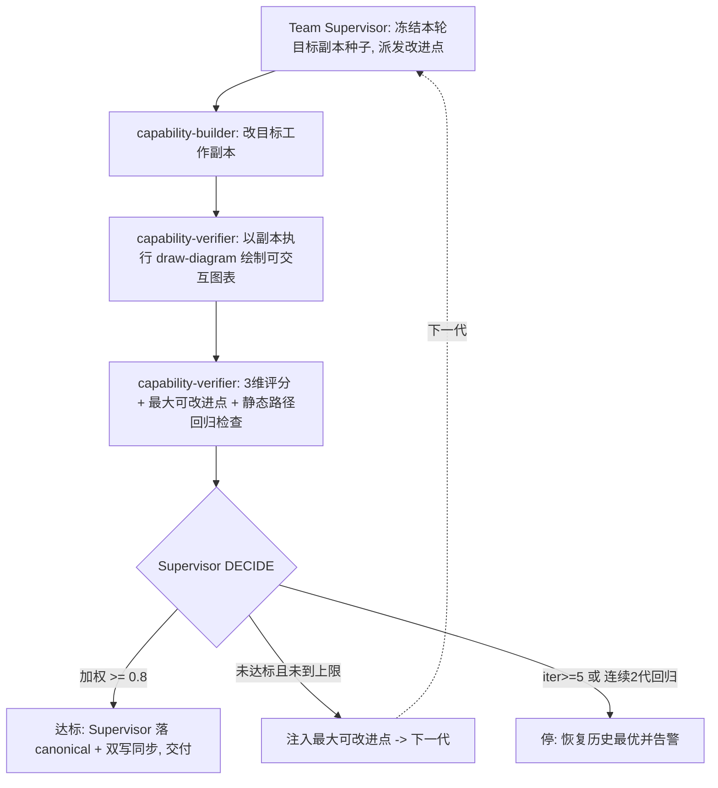

## Goal

**北极星(可验证)**:draw-diagram 技能具备绘制**可交互图表**的能力——图表可根据用户输入做出调整,通常以网页格式交付。

- **判据(1 条,权威见 goal 定义)**:通过 draw-diagram 技能能够绘制出可交互的图表(通常是网页格式)。判据按程度测量,达标线由本团队 `config.threshold` 承载(加权评分 ≥ 0.8)。
- **边界**:「动态」仅指图表随用户输入做出调整(交互的结果),**不含**动画/动图/视频等形式上的动态。
- **权威性**:goal 内容的单一事实源是 `goal_slug` 指向的定义文件;本节为可读性渲染,不一致时以定义为准并显式报出。

> 静态结构(谁参与)与动态结构(怎么协作)都仅为达成此 goal 而存在。

## Static Structure

Role × Stage × Type 花名册(全部 temporary,按 run 从模板实例化;`skill-verifier` 复用既有持久模板):

| Member | Role | Stage | Type | Lifecycle | 职责 |
|--------|------|-------|------|-----------|------|
| team-supervisor | team-supervisor | Meta(全阶段) | **Meta** | temporary | 定义质量维度/阈值;分解目标派发子任务;评分决策(accept/improve/halt);**唯一 canonical 落盘者**——把采纳的技能补丁落 `skills/external/draw-diagram/` 并执行双写同步 |
| capability-builder | skill-capability-builder | executor | **Meta**(操作对象=技能定义) | temporary | 设计并实现可交互图表能力:只改 `optimization_target` 的**工作副本**(运行工作区内),产出定义类补丁,不写 canonical |
| capability-verifier | skill-verifier | evaluator | **Meta**(操作对象=技能执行效果与证据) | temporary | 以当前采纳的目标副本**实际执行** draw-diagram 绘制可交互图表,产出被评分交付物;按 3 维度评分并给「最大可改进点」;回归检查既有静态路径 |

**约束**:iteration 团队恰含**一个** Team Supervisor(Meta)。交付物为技能定义(定义类文件)→ Worker MUST NOT 直写 canonical,由 Supervisor 落盘(消解条款)。

## Dynamic Structure

**Pattern**:`iteration`(单谱系收敛——能力建设非多角度锦标赛,不设 variants/淘汰)。

**Loop 设置**:`threshold=0.8` · `max_iterations=5` · `regression_limit=2` · 三维权重 交互 0.45 / 正确 0.25 / 整合 0.30。

**握手**:file-path-only。capability-builder 在 `.specify/teams/.work/draw-diagram-interactive/gen-<N>/target-copy/` 改目标副本;capability-verifier 以该副本执行技能,产物与评分卡写入 `gen-<N>/`;canonical 落盘与双写同步只在达标采纳时由 Supervisor 执行。运行中间态全部留在 git-ignored 的 `.work/<slug>/`;最终交付物只落 `optimization_target` 真实路径 + 镜像副本。

### 单代执行流

**每代五相**(iteration 标准相位):
1. **COORDINATE** — Supervisor 以上轮评分为种子,给 capability-builder 派改进子任务(territory = 本代工作副本目录)。
2. **EXECUTE** — builder 改目标工作副本(优化目标不变式:只改目标,不手改被评产物)。
3. **EVALUATE** — verifier 以副本**真实执行技能**再生产交付物并评分(含回归检查)。
4. **DECIDE** — 加权 ≥ 0.8 → 达标停;`iteration ≥ 5` 或连续 2 代回归 → 停并恢复历史最优;否则继续。
5. **IMPROVE** — 把 verifier 的「最大可改进点」注入下一代派发。

### Loop Card

| 相 | 内容 |
|----|------|
| **WHEN** | 用户发起 `/speckit.team run draw-diagram-interactive` |
| **SEE** | goal 定义(`.specify/goal/draw-diagram-interactive/goal.md`)+ 上轮 `runs/` 报告与评分历史 |
| **DO** | 一个迭代代:派 builder 改目标副本 → verifier 以副本执行技能产出交互图表 → 三维评分 |
| **CHECK** | 加权评分(交互 0.45/正确 0.25/整合 0.30)+ verifier 判据「经技能能绘制出随输入调整的网页图表」+ 既有静态路径回归 |
| **STOP** | threshold 0.8 达标 / iteration ≥ 5 / 连续 2 代回归(regression_limit) |
| **LEAVE** | `runs/<UTC-timestamp>-report.md`、评分历史、采纳副本由 Supervisor 落 canonical + 双写同步(diff -rq 校验)、goal summary 按门刷新 |

## Self-Improvement Contract

- Subject: this persisted team definition; member executions are evidence.
- Observe: completed run reports and Post-Run Critique.
- Improve: follow `.specify/shared/workflow/self-improvement-workflow.md`; route through `improve-team`.
- Boundary: preserve team authority, maturity gates, budget, kill-switch, and verifier independence.
- Verify: validate now and wait for a comparable later run before claiming improvement.
